# 健身会员智慧管理系统 — 论文（第一版）

> **版本**：论文（第一版）　—　在 v2.1（轻量知识库 + 会话历史持久化 + 用户数据隔离）基础上补齐界面截图证据与系统测试报告
> **基线**：业务系统 `gym-management-system`（SpringBoot 2.7 / Java 8）＋ 对话式智能体 `fitness-agent`（SpringBoot 3.2 / Java 17）＋ 统一前端 `fitness-web`（Vue 3）
> **编制日期**：2026-10-11
> **取代**：v2.0（全平台重写版）；v1.0（仅覆盖业务系统的旧稿，见文末"版本沿革"）

---

## 0. 文档说明

### 0.1 文档范围

本文档描述**当前运行态**的完整系统：一个业务后端、一个对话式 AI 智能体、一个统一前端与一个 MySQL 数据库，共四容器协作的健身会员智慧管理平台。文档基于源码逆向 + 实测验证编写，所有数据（行数、接口数、截图）均为真实测量值，非估算。

### 0.2 读者对象

| 读者 | 关注章节 |
|---|---|
| 开发者 | 第 3、4、5、6、7 章 |
| 运维/部署 | 第 8 章、附录 B |
| 产品/评审 | 第 1、2 章、第 7 章 |
| 测试 | 第 7 章、第 10 章 |

### 0.3 图表规范

1. **配色**：全文图示一律黑白灰（无彩色），便于黑白打印与制版。
2. **ER 图**：关系总览只画实体与连线；**每个实体的属性图单独成图**，避免一张大图挤作一团。
3. **记法**：UML 图（用例/类/时序/状态/活动）遵循 UML 2.x 记法；架构图采用分层方框图；数据流图采用 Yourdon/DeMarco 记法的简化变体。

---

## 1. 项目概述

### 1.1 项目背景
<!--SHOT:11-dashboard.png-->
<figure class="shot">
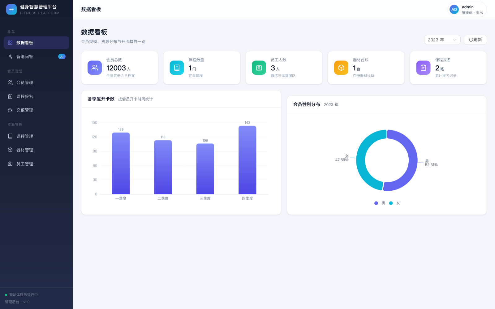
<figcaption>截图 1　系统总览：四容器全部启动后，业务数据看板正常渲染，验证全栈联通</figcaption>
</figure>
<!--/SHOT-->


面向中小型健身场馆的会员智慧管理平台。在既有业务系统（会员档案、课程报名、器材台账、员工管理、充值流水）之上，叠加一个**对话式 AI 智能体**，并把**会员端的全部交互收敛到对话里**：

> **管理端保留传统后台做运营；管理员之外的用户，一切交互都通过智能体对话完成。**

会员登录后直达对话页，没有表单——查余额、查积分、查课程、一句话发起点充值、扫码支付、生成健身计划，全程说人话。

### 1.2 系统目标

| 目标维度 | 具体指标 | 当前实测 |
|---|---|---|
| 功能覆盖 | 会员全生命周期（注册→开卡→充值→报名→签到→续费） | 已达成 |
| 对话闭环 | 一句话充值 → 确认 → 扫码 → 到账回执，余额真加 | 已达成（129→929 全程实测） |
| 意图识别 | 少量业务场景下识别准确率 100% | 16 单轮 + 多轮 + 边界全过 |
| 数据资产 | 9 张业务表，订单复用充值流水表 | 已达成（rechargeStatus 0/1/2） |
| 角色隔离 | 管理员后台运营 / 会员对话自助，功能与数据双隔离 | 已达成 |
| 部署形态 | 容器化四节点，一键启动 | 4 容器 healthy |
| 降级能力 | 大模型不可用时规则引擎兜底，永不空手而归 | status=DEGRADED 实测可用 |

### 1.3 设计原则

| 原则 | 含义 | 落点 |
|---|---|---|
| 对话优先 | 会员端无表单；短答（"好""200""我付好了"）在待办状态下有确定语义 | fitness-agent / 对话页 |
| 证据驱动 | BMI/BMR/TDEE 全部公式计算并标注来源，大模型只组织语言，不允许编数字 | HealthMetricsService |
| 永不空手而归 | LLM 未配置/超时/返回非法，一律降级规则引擎 | RuleBasedPlanBuilder |
| 集成但独立 | 智能体不直连业务库，只走 REST；两套镜像独立构建发版 | /agentBridge 薄接口 |
| 资金安全 | 订单条件更新实现幂等，重复支付不重复入账 | markRechargePaid |
| 密钥不落库 | 用户自填的 LLM Key 只存浏览器，随请求头下发 | X-LLM-* / localStorage |

### 1.4 技术选型

#### 1.4.1 业务系统（gym-management-system）

| 层次 | 技术 | 版本 | 选型理由 |
|---|---|---|---|
| 后端框架 | SpringBoot | 2.7.2 | 自动装配，内嵌 Tomcat，独立部署 |
| ORM | MyBatis | 3.5.10 | SQL 可控，注解 + XML 双模式 |
| 数据库 | MySQL | 8.0 | 事务支持，utf8mb4 中文兼容 |
| 鉴权 | JJWT | 0.9.1 | 无状态令牌 |
| 工具库 | Hutool / Apache POI | 5.8.5 / 5.2.2 | Excel 导入导出 |
| 构建 | Maven | 3.9 | 标准化依赖管理 |

#### 1.4.2 智能体（fitness-agent）

| 层次 | 技术 | 版本 | 选型理由 |
|---|---|---|---|
| 框架 | SpringBoot | 3.2 / Java 17 | 与业务系统版本解耦，独立演进 |
| LLM 接入 | OpenAI 兼容协议（DeepSeek） | — | base-url 一行可换成通义/vLLM/Ollama |
| HTTP 客户端 | Spring RestClient | 6.1 | 声明式调用业务系统 |
| 观测 | Spring Actuator | — | /actuator/health 供容器健康检查 |

#### 1.4.3 统一前端（fitness-web）

| 层次 | 技术 | 版本 | 选型理由 |
|---|---|---|---|
| 框架 | Vue 3 | 3.4 | 组合式 API，体积小 |
| 组件库 | Element Plus | 2.x | 中后台组件 |
| 可视化 | ECharts | 5.5 | 看板图表 |
| 路由 | Vue Router 4（history 模式） | 4.x | SPA 路由 |
| 二维码 | qrcodejs | 1.0.0 | 本地生成支付二维码 |
| 托管 | Nginx 1.25-alpine | — | 静态托管 + 同源反代，零跨域 |

> 前端依赖全部本地化到 `assets/vendor/`（共 2.5MB），镜像构建不需要 npm、不需要访问 CDN。

### 1.5 交付物规模（实测）

| 模块 | 规模 | 说明 |
|---|---|---|
| fitness-agent（Java） | 7080 行 / 68 个类 | 10 服务 + 13 DTO + 4 客户端 + 5 控制器 + 知识库/存储/归属三组基础设施 |
| 知识库语料（Markdown） | 63 篇 / 2706 行 / 正文约 2.6 万字 | 5 分类（动作 30 / 训练 11 / 计划 8 / 营养 8 / 安全 6），349 章节，221 条常见问法 |
| fitness-web（前端） | 4167 行 / 23 文件 | 纯静态，无构建步骤；新增知识库浏览页 |
| 业务系统新增桥接 | 255 行 / 4 文件 | AgentBridge Controller/Service/Mapper + identity |
| 业务系统原有 | 约 61 接口 / 10 控制器 | 本轮业务代码零改动 |
| 数据库 | 业务库 9 表 + 智能体库 2 表 | 真实 COUNT 见 10.3 / 10.6 |
| 自动化测试脚本 | 6 个 / 198 项断言 | intent / prompt / knowledge / session / 截图 / 文档渲染 |
| 截图验证 | 24 张（v2.0 二十 + v2.1 四） | 全链路零页面错误 |

---

## 2. 需求分析

### 2.1 核心业务流程：一句话充值闭环

系统最关键的一条业务流：会员一句话发起充值，对话给出确认卡，确认后生成订单与二维码，手机扫码进入支付页（顶部为反电诈警示），支付后电脑端轮询自动发现到账并弹出回执。**余额真实变动，且幂等。**

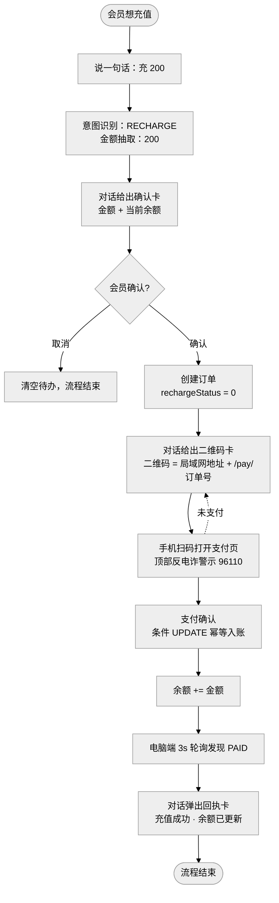

### 2.2 用例图

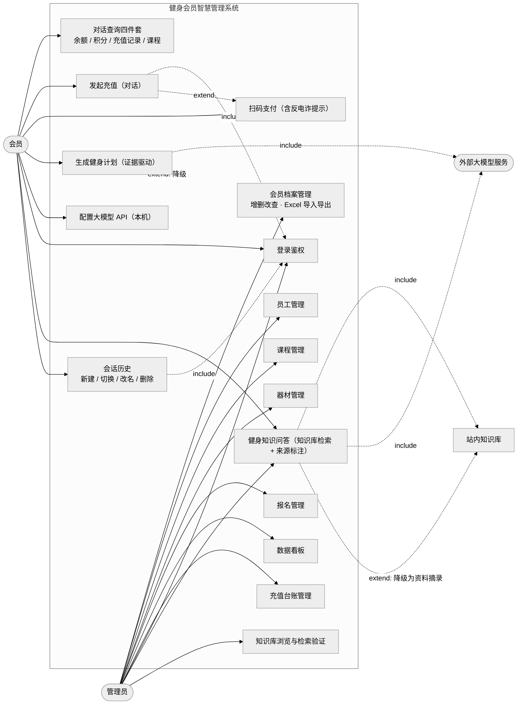

### 2.3 关键用例规约

#### UC-09 发起充值（对话式）
<!--SHOT:22-member-confirm.png-->
<figure class="shot">
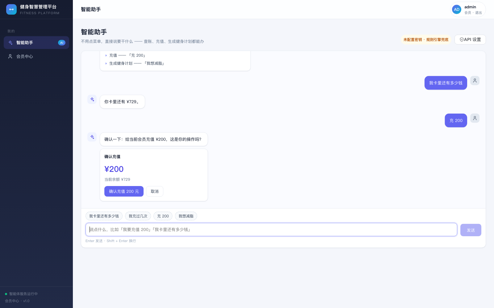
<figcaption>截图 3　发起充值先出确认卡，金额原样回显，防手滑</figcaption>
</figure>
<!--/SHOT-->


| 项 | 内容 |
|---|---|
| 参与者 | 会员 |
| 前置条件 | 会员已登录（memberNo 由登录态锁定） |
| 触发 | 会员说出含充值意图的话，如「充 200」「帮我充五百」「我要充值」 |
| 主流程 | ① 意图识别为 RECHARGE 并抽取金额 → ② 金额缺失则追问 → ③ 出确认卡（金额+余额）→ ④ 确认后创建订单 → ⑤ 出二维码卡 |
| 备选流 | 金额非法（<1 或 >10000）：拒绝并说明范围；非会员上下文：拒绝并引导用会员账号 |
| 后置条件 | recharge 表新增一条 rechargeStatus=0 的订单；对话待办置为 PAY |
| 业务规则 | 金额必须为 1–10000 的整数；订单幂等入账 |

#### UC-10 扫码支付
<!--SHOT:23-member-pay-qr.png-->
<figure class="shot">
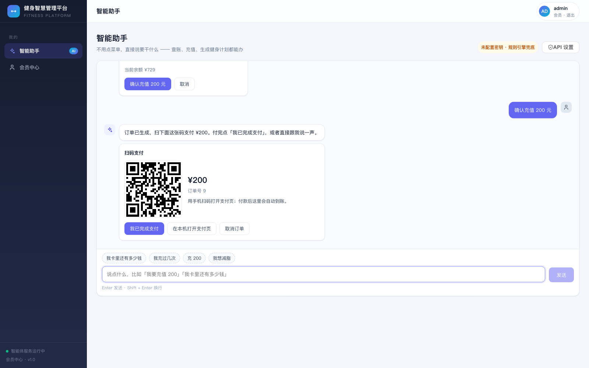
<figcaption>截图 4　确认后生成订单并弹出支付二维码</figcaption>
</figure>
<!--/SHOT-->

<!--SHOT:24-pay-page.png-->
<figure class="shot">
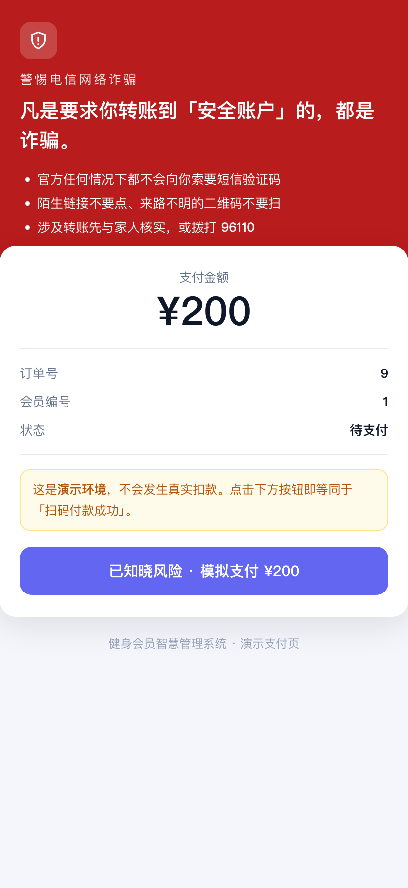
<figcaption>截图 5　扫码进入公开支付页，顶部反电诈大字警示</figcaption>
</figure>
<!--/SHOT-->


| 项 | 内容 |
|---|---|
| 参与者 | 会员（手机端，无登录态） |
| 前置条件 | 存在待支付订单 |
| 主流程 | 扫码 → 打开 /pay/订单号（公开路由）→ 顶部反电诈警示 → 确认支付 → 条件 UPDATE 置为已支付 → 余额增加 |
| 备选流 | 订单已支付：直接显示已完成状态（幂等）；订单不存在：错误提示 |
| 后置条件 | rechargeStatus=1，member.memberChange 增加，对话端轮询弹出回执 |
| 业务规则 | `UPDATE recharge SET status=1 WHERE no=? AND status=0`，影响行数为 0 即视为已支付，不再加钱 |

#### UC-11 生成健身计划（证据驱动）
<!--SHOT:14-agent-chat-plan.png-->
<figure class="shot">
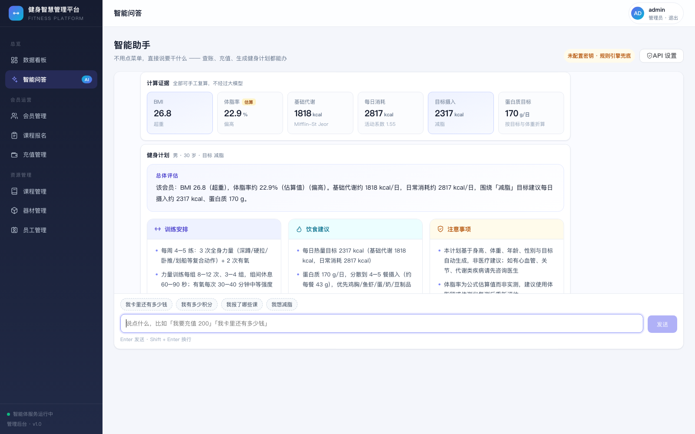
<figcaption>截图 6　多轮补齐身体数据后产出计划，并附规则引擎的计算证据</figcaption>
</figure>
<!--/SHOT-->


| 项 | 内容 |
|---|---|
| 参与者 | 会员 / 管理员 |
| 前置条件 | 具备性别、年龄、身高、体重（可从会员档案带入，或对话中抽取） |
| 主流程 | 槽位抽取 → 后端公式计算 BMI/BMR/体脂/TDEE/目标热量/蛋白质 → LLM 组织语言 → 返回计划 + 计算证据 |
| 备选流 | LLM 未配置/超时/返回非法 JSON：降级规则引擎（status=DEGRADED）；槽位缺失：追问补齐 |
| 后置条件 | 返回计划与全部计算证据（可手工复算） |
| 业务规则 | 中国 BMI 标准；Mifflin-St Jeor BMR；Deurenberg 体脂估算；目标热量设安全下限 |

#### UC-12 健身知识问答（知识库检索 + 来源标注）
<!--SHOT:31-agent-knowledge-answer.png-->
<figure class="shot">
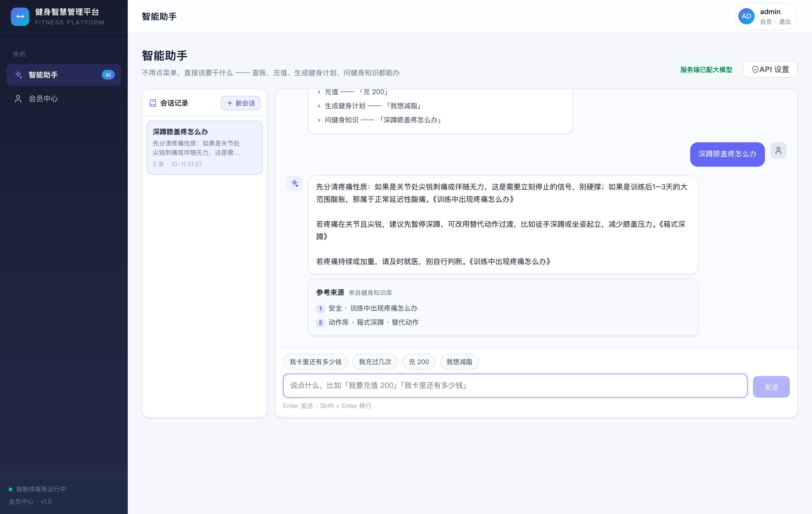
<figcaption>截图 7　回答内联标注来源标题，底部附「参考来源」卡</figcaption>
</figure>
<!--/SHOT-->


| 项 | 内容 |
|---|---|
| 参与者 | 会员 / 管理员 / 访客 |
| 前置条件 | 无（知识问答不依赖会员身份，也不需要登录） |
| 触发 | 用户提出健身知识问题，如「深蹲膝盖疼怎么办」「蛋白质吃多少」 |
| 主流程 | ① 意图路由命中 QUERY_KNOWLEDGE（主题词 + 疑问词，且非强计划诉求）→ ② 内存索引 BM25 检索 → ③ 命中分数 ≥ min-score → ④ 拼「要点 + 命中段落」参考资料 → ⑤ LLM 据资料组织语言 → ⑥ 后置校验通过 → ⑦ 返回回答 + **来源卡**（篇目 · 章节） |
| 备选流 | 检索为空或低于阈值：转兜底话术，**不硬答**；LLM 不可用或输出越界：直接给出资料原文摘录；非健身语境（如「今天天气怎么样」）：检索不到 → 兜底引导 |
| 后置条件 | 回答与来源一并落库，可在会话历史中回看 |
| 业务规则 | 只依据检索到的资料作答；不做医疗诊断；不推荐药物与补剂；来源必须标注 |

#### UC-13 会话历史与数据隔离
<!--SHOT:32-agent-session-sidebar.png-->
<figure class="shot">
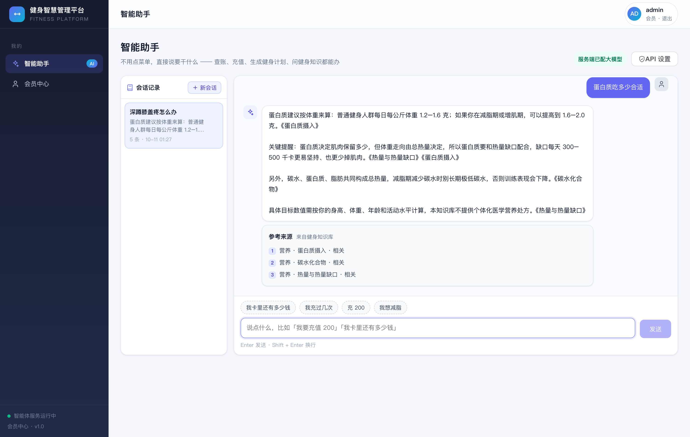
<figcaption>截图 8　同一会话累计多条消息，侧栏预览随之更新，证明历史已落库续接</figcaption>
</figure>
<!--/SHOT-->


| 项 | 内容 |
|---|---|
| 参与者 | 会员 / 管理员 / 访客（访客为浏览器级隔离） |
| 前置条件 | 具备可识别的归属：登录 token，或浏览器本地标识 |
| 触发 | 任何一轮对话（自动落库）、打开历史列表、切换/改名/删除会话 |
| 主流程 | ① 从请求头解析归属（token → 业务系统 /agentBridge/identity；否则用 X-Client-Id）→ ② 归属落库、会话键由服务端生成 → ③ 追加本轮消息 → ④ 响应回带 sessionKey |
| 备选流 | 库不可用：静默降级为"不落库"，对话功能不受影响；无任何凭据：不记录（宁可不存，也不落公共桶）；带了别人的 sessionKey：**不沿用，而是另开新会话**；读取/删除/改名他人会话：一律"查无此会话" |
| 后置条件 | chat_session / chat_message 落库；归属校验体现在**每一句 SQL 的 WHERE 条件**上 |
| 业务规则 | 会话标识由服务端生成，绝不采用调用方传来的 key 建会话；访客归属标记为"未验证"，不冒充账号级隔离 |

### 2.4 角色功能矩阵
<!--SHOT:10-login.png-->
<figure class="shot">
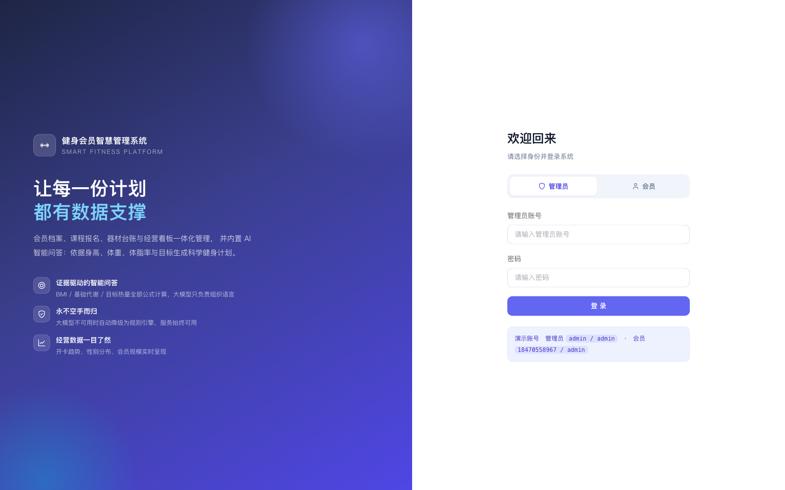
<figcaption>截图 2　双身份登录入口：角色决定进入后台运营还是对话自助</figcaption>
</figure>
<!--/SHOT-->


| 功能模块 | 管理员 | 会员 | 载体 |
|---|:---:|:---:|---|
| 登录鉴权 | Y | Y | 登录页（双身份切换） |
| 会员档案管理 | Y | — | 会员管理页 |
| 员工管理 | Y | — | 员工管理页 |
| 课程管理 | Y | — | 课程管理页 |
| 器材管理 | Y | — | 器材管理页 |
| 报名管理 | Y | — | 课程报名页 |
| 充值台账 | Y | — | 充值管理页 |
| 数据看板 | Y | — | 数据看板页 |
| **对话查询（余额/积分/充值记录/课程）** | 受限（需会员上下文） | Y | **对话页** |
| **对话发起充值 + 扫码支付** | — | Y | **对话页 + 支付页** |
| **对话生成健身计划** | Y | Y | **对话页** |
| **对话问健身知识（带来源）** | Y | Y | **对话页** |
| **会话历史（新建/切换/改名/删除）** | Y（管理员身份） | Y | **对话页·左侧会话栏** |
| 知识库浏览与检索验证 | Y | — | 知识库页 |
| 大模型 API 自助配置 | Y | Y | 对话页·API 设置 |
| 会员中心（兜底） | — | Y | 会员中心页 |

> 管理员的对话页没有会员上下文：查账与充值一律引导"请用会员账号"，**不猜目标会员**。
> 知识问答与会话历史不受此限制——它们与"目标会员是谁"无关，访客也能用（归属为浏览器级隔离）。

### 2.5 非功能需求

| 类别 | 要求 | 现状 |
|---|---|---|
| 性能 | 单接口响应 < 3s；智能体读业务超时 8s、LLM 读超时 45s | 已配置 |
| 性能 | 知识检索为内存计算，不引入 embedding 服务与向量库 | 已实现（63 篇全量索引 < 10ms） |
| 安全 | LLM 密钥不落库不落日志；资金操作幂等；支付页反电诈提示 | 已实现 |
| 安全 | 会话数据按归属隔离，校验落在 SQL WHERE 层 | 已实现（见 9.3） |
| 可用性 | 容器 unless-stopped；MySQL healthcheck 串接启动顺序；LLM 故障自动降级 | 已实现 |
| 可用性 | 会话库不可用时降级为"不落库"，对话功能不受影响 | 已实现 |
| 兼容性 | 移动端支付页窄屏适配；桌面端后台适配 | 已实现 |
| 可维护性 | 三层分层；智能体与业务系统版本解耦；前端零构建 | 已实现 |
| 可维护性 | 知识库以卷挂载热更新，改 Markdown 无需重建镜像 | 已实现（60s 刷新周期） |
| 可观测 | /actuator/health；容器级健康检查；对话日志含降级原因 | 已实现 |
| 可观测 | 检索命中篇数与来源写入日志；/knowledge/search 可复现检索结果 | 已实现 |

---

## 3. 系统总体设计

### 3.1 总体架构图

四容器协作，单入口同源反代，前端零跨域。智能体另挂一个只读知识库卷，并持有一份自己的会话库 schema。

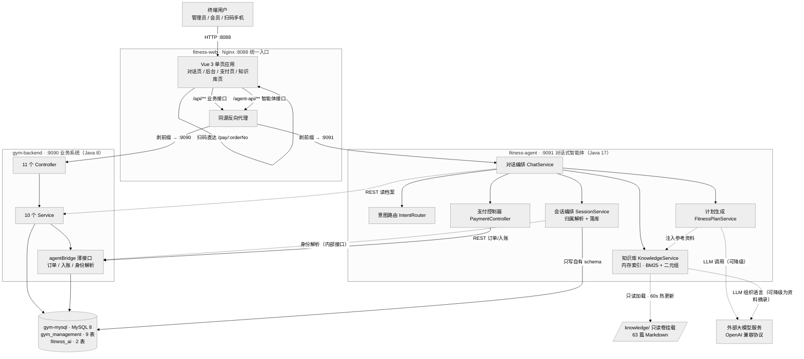

### 3.2 逻辑架构图（子系统划分）

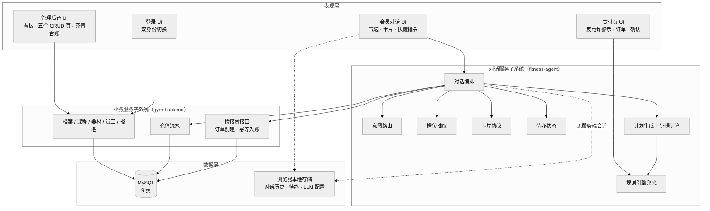

### 3.3 技术架构图

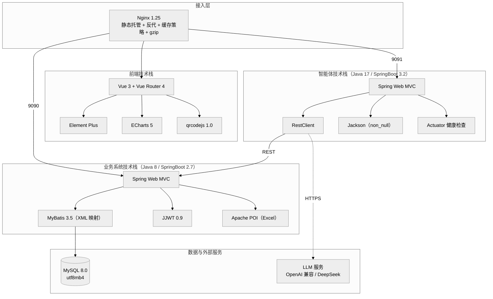

### 3.4 数据架构图

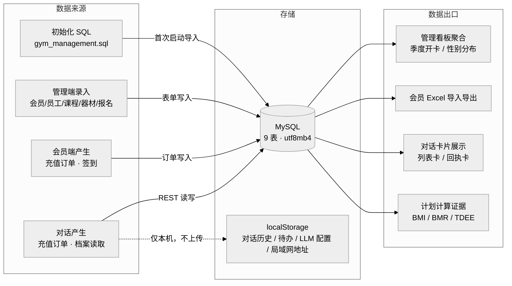

> **数据主权约定**：会员的 LLM Key、对话历史、待办状态只存在浏览器本地；服务端无会话存储、不保存密钥。

### 3.5 安全架构图

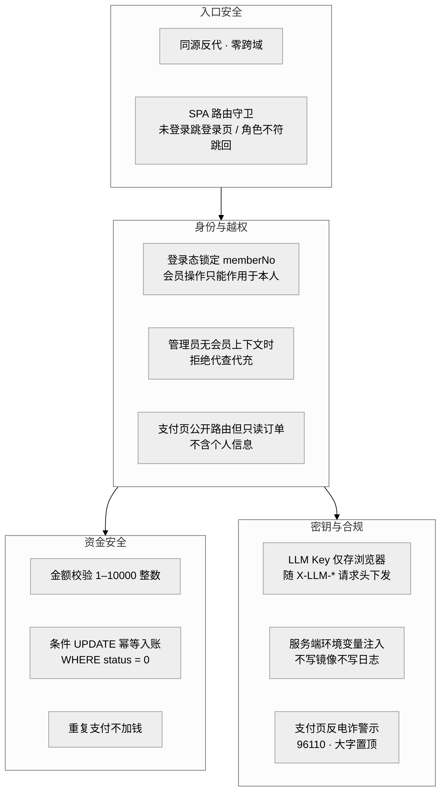

### 3.6 部署架构图

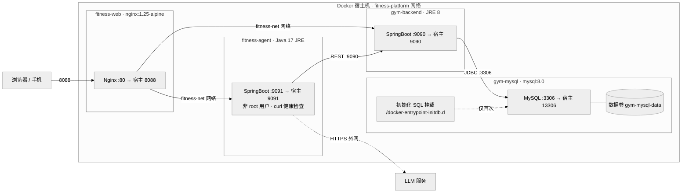

### 3.7 前端组件图

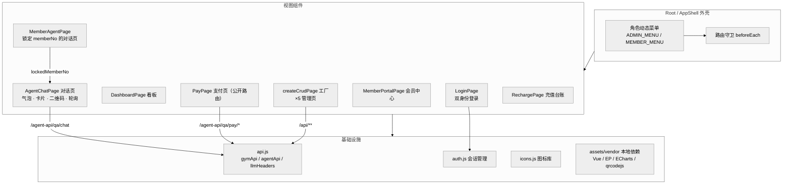

### 3.8 包图

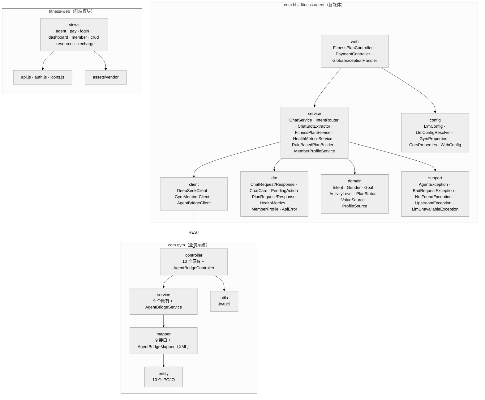

### 3.9 智能体核心类图

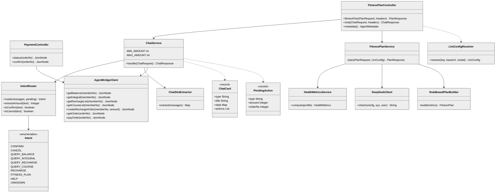

### 3.10 业务桥接类图

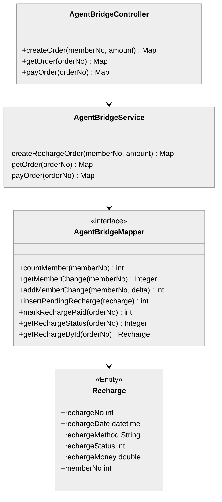

> 桥接接口是本轮**唯一**对业务系统的代码新增（4 文件 255 行）；原有 10 个控制器的业务代码零改动。

### 3.11 数据流图（DFD）

#### 顶层上下文图（Context Diagram）

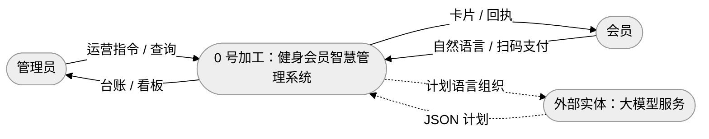

#### 0 层图（Level 0）

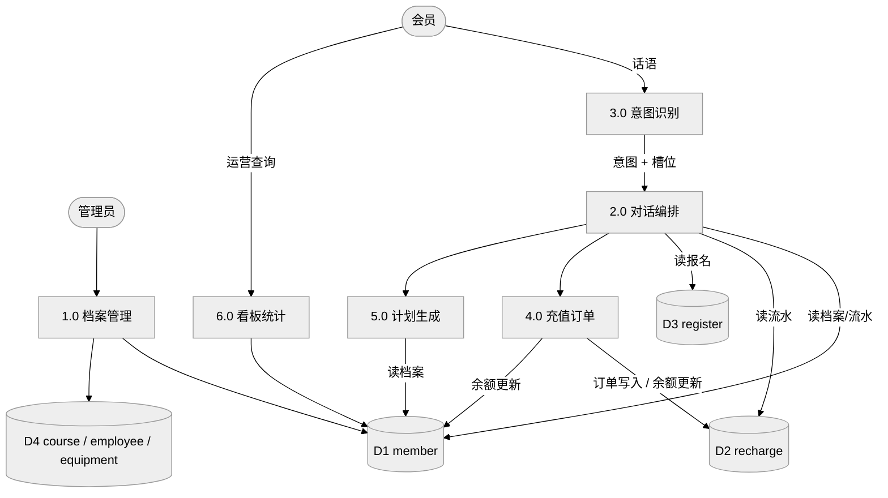

### 3.12 知识库与会话存储类图

本轮新增的两组类：**左侧是知识库**（只读、内存索引、可热更新），**右侧是会话存储与归属**（只写自有 schema、校验落在数据访问层）。两者共同点是不依赖任何外部中间件——知识库不引入向量库，会话库不引入 ORM 与迁移框架。

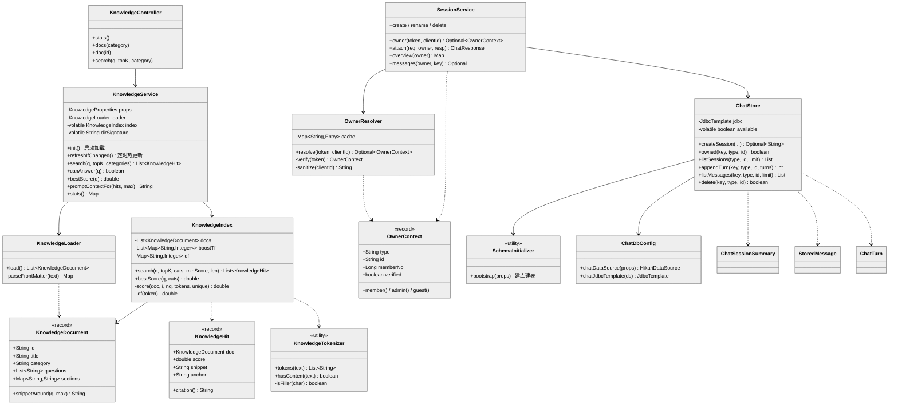

> 两个"刻意的缺席"值得说明：知识库没有 `EmbeddingClient`，会话存储没有 `Repository/Entity/迁移文件`。
> 前者是因为 63 篇量级下词法检索够用且可解释，后者是因为只维护两张表、且是自带库的形态——引入 ORM 与迁移框架带来的协调成本大于收益。

---

## 4. 对话式智能体设计（fitness-agent）

### 4.1 意图分类与路由
<!--SHOT:12-agent-chat-idle.png-->
<figure class="shot">
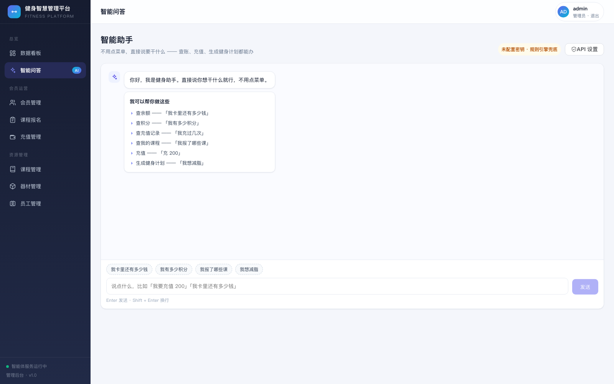
<figcaption>截图 9　对话页首屏（管理员）：问候语 + 能力清单 + 快捷指令</figcaption>
</figure>
<!--/SHOT-->

<!--SHOT:20-member-agent-idle.png-->
<figure class="shot">
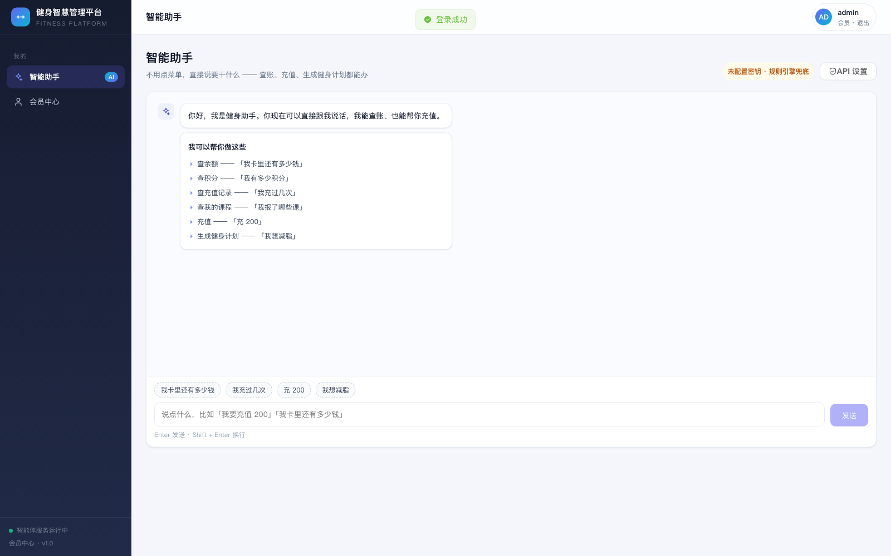
<figcaption>截图 10　对话页首屏（会员）：同样无表单，直接对话</figcaption>
</figure>
<!--/SHOT-->


意图分四层，路由严格按层判定。**第 2 层高于第 3 层是刻意的**：「充值记录」必须识别成查询，不能因为里面有"充值"两个字就被当成发起充值。

| 层 | 意图 | 触发示例 | 说明 |
|---|---|---|---|
| 1 等待态短答 | CONFIRM / CANCEL | 好、确认 / 算了、不充了 | 仅在上一轮留下待办时才有意义；限制短文本防误匹配 |
| 2 查询类 | QUERY_BALANCE / QUERY_INTEGRAL / QUERY_RECHARGE / QUERY_COURSE | 我卡里还有多少钱 / 我有多少积分 / 我充过几次 / 我报了哪些课 | 只读，优先级高于动作类 |
| 3 动作类 | RECHARGE / FITNESS_PLAN | 充 200 / 我想减脂 | 会改数据或产生新内容 |
| 4 兜底 | HELP / UNKNOWN | 你能做什么 / 今天天气怎么样 | 绝不猜，给能力清单 |

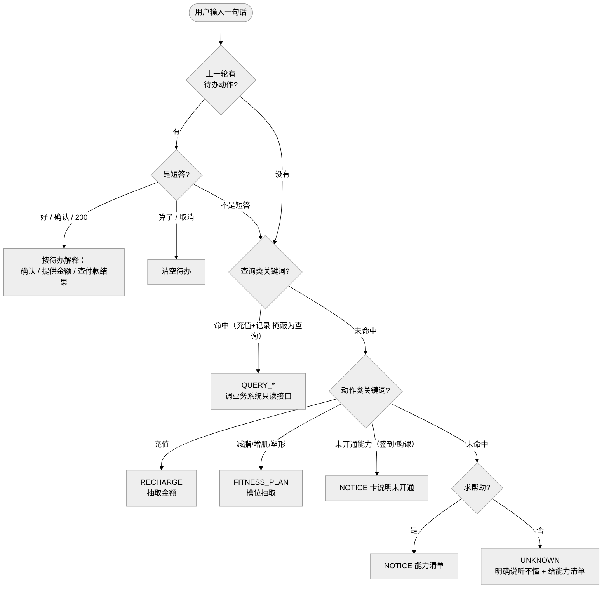

### 4.2 槽位抽取（ChatSlotExtractor）

纯规则实现，不依赖大模型。支持从一段话中抽取健身计划所需的身体数据，并做单位归一化与范围校验。

| 槽位 | 归一化规则 | 校验 |
|---|---|---|
| 性别 | 男/女 → MALE/FEMALE | 枚举 |
| 年龄 | 岁 | 10–90 |
| 身高 | cm；"1米78"→178 | 100–250 |
| 体重 | kg；"140斤"→70 | 25–300 |
| 体脂率 | % | 3–70 |
| 目标 | 减脂/增肌/塑形 → LOSE_FAT/GAIN_MUSCLE/SHAPE | 枚举 |
| 活动水平 | 久坐/轻度/中度/高度 → 1.2/1.375/1.55/1.725 | 枚举 |

> 一句复合话即可填满全部槽位：「我想减脂，男，30岁，178cm，85公斤」→ 5 个槽位全中，直接出计划。

### 4.3 卡片协议（ChatCard）
<!--SHOT:21-member-balance.png-->
<figure class="shot">
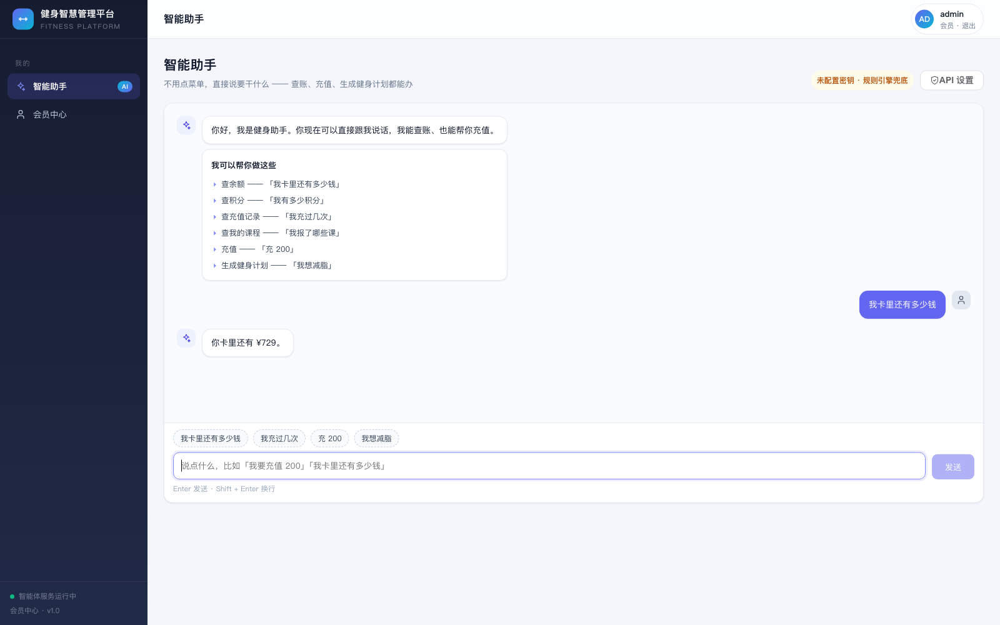
<figcaption>截图 11　余额查询卡：口语化提问，回复带真实数值</figcaption>
</figure>
<!--/SHOT-->

<!--SHOT:27-member-recharge-list.png-->
<figure class="shot">
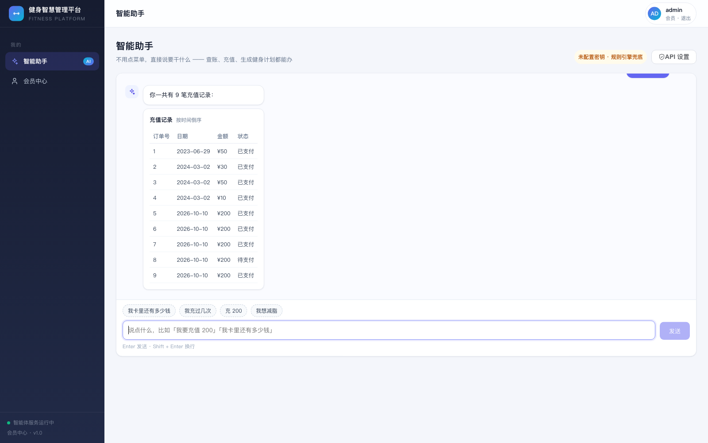
<figcaption>截图 12　「充值记录」判为查询而非充值，返回含真实订单的列表卡</figcaption>
</figure>
<!--/SHOT-->


**文字负责说，卡片负责办。** 这是交互不"呆板"的关键。

| type | data 结构 | actions | 用途 |
|---|---|---|---|
| CONFIRM | amount, balance | confirm / cancel | 充值确认（防手滑） |
| PAY | orderNo, amount, qrPath | paid / open / cancel | 支付二维码卡 |
| LIST | columns[], rows[][], empty | — | 查询结果表格 |
| RECEIPT | orderNo, amount, balance | — | 到账回执 |
| NOTICE | items[] | — | 能力清单 / 未开通提示 |

卡片按钮的 `label` 只作气泡展示文案；真正回传给服务端的是**种子词**（确认 / 算了 / 我付好了），避免按钮文案污染语义。

### 4.4 待办状态机（PendingAction）

服务端**无状态**：对话历史与待办由前端保管并随每次请求回传。这是让短答有意义的核心机制。

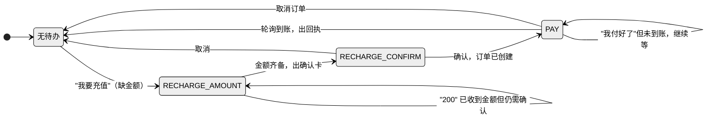

| 待办类型 | 含义 | 短答的语义 |
|---|---|---|
| RECHARGE_AMOUNT | 已识别充值意图，等金额 | "200" → 金额 |
| RECHARGE_CONFIRM | 金额已知，等点头 | "好" → 确认 |
| PAY | 订单已创建，等付款 | "我付好了" → 查订单状态 |

### 4.5 降级链路（永不空手而归）

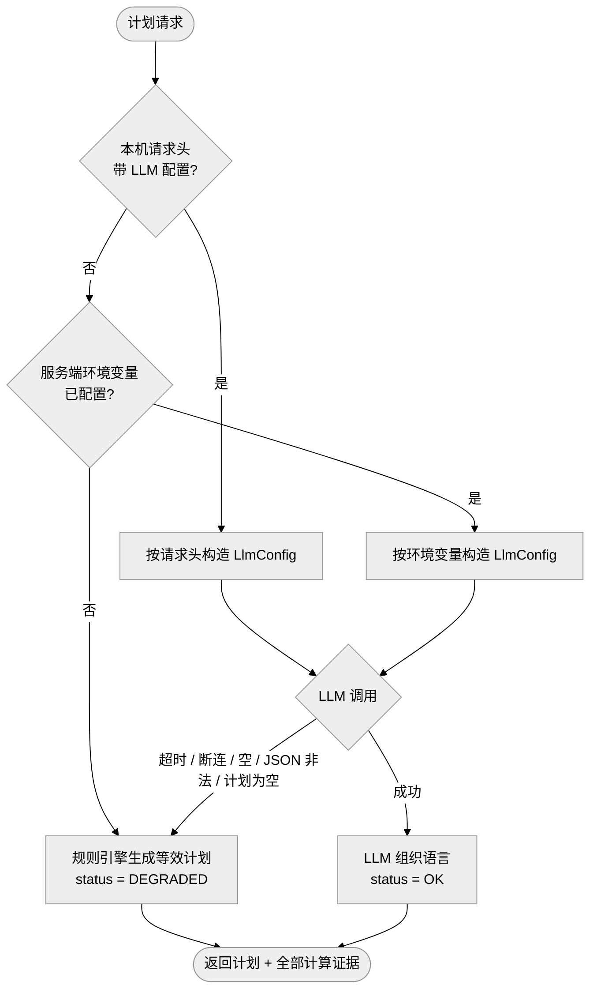

降级触发点全覆盖：未配置密钥、连接超时（5s）、读超时（45s）、返回空内容、JSON 非法、计划为空。任一发生都自动切规则引擎，**服务始终有产出**。

### 4.6 大模型配置注入

配置有三优先级，逐级回退：

| 优先级 | 来源 | 存储 | 说明 |
|---|---|---|---|
| 1 | 请求头 `X-LLM-Api-Key / X-LLM-Base-Url / X-LLM-Model` | 用户浏览器 localStorage | 用户在对话页「API 设置」自填 |
| 2 | 服务端环境变量 `DEEPSEEK_API_KEY / FITNESS_LLM_BASE_URL / FITNESS_LLM_MODEL` | 容器环境变量 | 部署级默认 |
| 3 | 规则引擎 | — | 都没有时兜底 |

> 硬约束：密钥一律不写进配置文件与镜像；日志中不输出 Key（`LlmConfig.describe()` 已脱敏）。

### 4.7 提示词工程

大模型在本系统中只承担两件事：**把规则引擎算好的数字组织成计划文案**、**在意图未命中时说一句得体的引导话术**。它不做意图识别、不做数值计算、不碰数据读写。提示词因此不是"随便写段话"，而是一份**有版本、有约束、有回归测试的接口契约**——全部集中在 `prompt/PromptLibrary`，是提示词的唯一来源。

#### 4.7.1 提示词清单

| 提示词 | 版本 | 用途 | 输出形态 | 调用点 |
|---|---|---|---|---|
| `PLAN_SYSTEM` | `plan-v2` | 生成健身计划 | 严格 JSON（4 字段） | `FitnessPlanService` |
| `FALLBACK_SYSTEM` | `fallback-v1` | 意图未命中时的引导话术 | 单句纯文本（≤80 字） | `FallbackReplyService` |
| `KNOWLEDGE_SYSTEM` | `kb-v1` | 基于知识库命中段落作答 | 纯文本（≤460 字，标注来源标题） | `KnowledgeAnswerService` |

版本随响应 `promptVersion` 字段回传并写日志（`LLM 调用成功 mode=json ...`、`智能体生成成功 ... prompt=plan-v2`），线上出现"输出变差"时可直接归因到具体版本。

#### 4.7.2 三层约束模型

计划类提示词按三层组织，层层收紧，任一层的失效都由代码兜住：

| 层 | 内容 | 目的 |
|---|---|---|
| **证据层** | 只许原样引用给定数值，禁止重算、禁止引入未提供数据（心率/血压/伤病/用药），拿不准就不写 | 杜绝幻觉数值——计划里每个数字都必须能追溯到规则引擎 |
| **边界层** | 不做医疗诊断、不推荐药物补剂、不承诺疗效、不建议极端饮食 | 把"越界"挡在生成阶段，避免合规与安全风险 |
| **契约层** | 固定 JSON 结构、各字段条数区间（training 4–6 / diet 4–6 / precautions 3–5）、单条 ≤60 字、无 markdown | 让输出可被程序稳定消费 |

契约之外还有**异常指标处置**规则：BMI 肥胖或体脂偏高必须给低冲击起步建议并建议就医；年龄 ≥60 或 BMI 偏瘦禁止安排高冲击动作——这些是"医疗安全"层面的硬要求，写进提示词而不是事后人工检查。

#### 4.7.3 兜底话术：软约束 + 硬校验

意图未命中时的话术生成是资金系统里**最危险**的调用：模型很容易热情过头说出「已为你充值 ¥200」，而实际什么都没发生。因此做了双保险：

**提示词软约束**（`FALLBACK_SYSTEM` 硬约束五条）：不得声称已完成任何操作、不得出现任何业务数据、不得提及白名单外能力、不闲聊不做通用问答、只输出一句话。

**代码硬校验**（`FallbackReplyService.violationOf`）——提示词是建议，校验是底线：

| 越界规则 | 正则/判据 | 处置 |
|---|---|---|
| 冒充已执行操作 | `已(经)?(为你\|帮你\|替您\|给您)\|已完成\|已入账\|已到账\|已充值\|已报名\|正在为你` | 丢弃话术，回退固定话术 |
| 编造业务数据 | `(余额\|积分\|订单号\|剩余)\D{0,4}\d` | 同上 |
| 含 markdown 格式 | ` ``` \| ** \| 行首 -/•/* \| 行首 1. ` | 同上 |
| 过长 / 行数过多 | >120 字 / >2 行 | 同上 |

任何异常（未配置密钥、超时、越界）一律返回空并回退固定话术——**兜底模块自己绝不能成为新的故障点**。

#### 4.7.4 提示词回归测试

提示词改动无法靠 code review 判断好坏，必须用真实模型跑回归。`tools/prompt_test.py` 定义两类被测对象：

**A. 计划生成**（5 组画像：增肌年轻男 / 减脂年轻女 / 大体重减脂 / 偏瘦塑形 / 高龄维持），每组校验：

- 结构：`status=OK`、`promptVersion=plan-v2`、四字段齐全、条数落在契约区间
- **证据引用**：计划正文必须出现规则引擎给出的目标热量与蛋白质数值（最核心的一项——数值对不上说明模型在自算）
- 安全：触发热量下限时必须有提醒
- 违禁内容：编造心率/血压/血糖、承诺疗效、推荐药物/补剂、极端饮食，7 条正则逐条查
- 格式：无 markdown 围栏、单条 ≤80 字

**B. 兜底话术**（6 句真实未命中语，含闲聊、越界请求、抱怨、越权），每句校验：未冒充已执行、未编造数据、未给计划加登录门槛、长度与格式、命中能力引导词。

实测结果：**134 项断言全部通过（0 失败）**。该脚本已随项目提供，改提示词后必跑：

```bash
python3 tools/prompt_test.py            # 默认打 http://localhost:8088/agent-api
```

#### 4.7.5 测试驱动修出来的两个缺口

写回归的过程中暴露了两个此前没人发现的问题，都已修复：

| 问题 | 现象 | 根因 | 修复 |
|---|---|---|---|
| 意图词典缺口 | "我想保持健康"被判未识别，走了兜底话术 | `PLAN_WORDS` 只收了「维持/保持身材」，收不下「保持健康」这类最普通的说法 | 补入「保持健康/健身/运动/体能/练一练」等通用诉求词 |
| 活动水平抽不准 | "每周练4次""想练两次"一律落到默认中等强度 | 关键词表只有固定短语，没有次数表达式 | 新增 `每周练N次` / `练N次` 正则（中文数字支持），按 1-2 / 3-5 / 6-7 次映射轻/中/高 |

> 这两条恰好说明"提示词工程"的边界：**提示词只能约束模型，约束不了规则层自身的盲区**。所以回归测试既测模型输出，也顺带压规则层，两边一起暴露。

#### 4.7.6 知识问答提示词（kb-v1）

`KNOWLEDGE_SYSTEM` 是三种提示词里**约束最重**的一份，因为它面对的是"开放提问"，模型最容易自由发挥。四条铁律：

| 铁律 | 内容 | 目的 |
|---|---|---|
| **只用资料作答** | 只许引用注入的参考段落；资料没有的，明说"这一点资料里没有提到" | 杜绝编造训练方法、剂量、时长 |
| **标注来源** | 回答里要带上命中文档的标题 | 让用户能自己回查，回答可追溯 |
| **数值定性** | 资料里的次数、时长、热量是**通用建议**，不是会员实测数据 | 与计划生成的"证据链"隔离（见下） |
| **不做医疗判断** | 不诊断、不推荐药物补剂、不承诺疗效 | 与 4.7.2 边界层一致 |

第三条是本轮的一个关键设计。计划生成要求"只许引用给定数值"，而知识库注入的恰恰是**文献性的通用数值**——两者天然冲突。解法是在注入上下文里显式声明：

> 【参考资料（来自本站健身知识库）】…… 注意：资料里的数值（如次数、时长、热量）是通用建议，不是本次会员的身体数据，不要当作会员的实测指标复述。

于是计划提示词的证据链不被污染：知识库给的是"一般怎么练"，规则引擎给的才是"你应该练多少"，二者在提示词里被明确分工。

---

### 4.8 知识问答：检索 → 生成 → 兜底（RAG 三段式）
<!--SHOT:29-knowledge-browse.png-->
<figure class="shot">
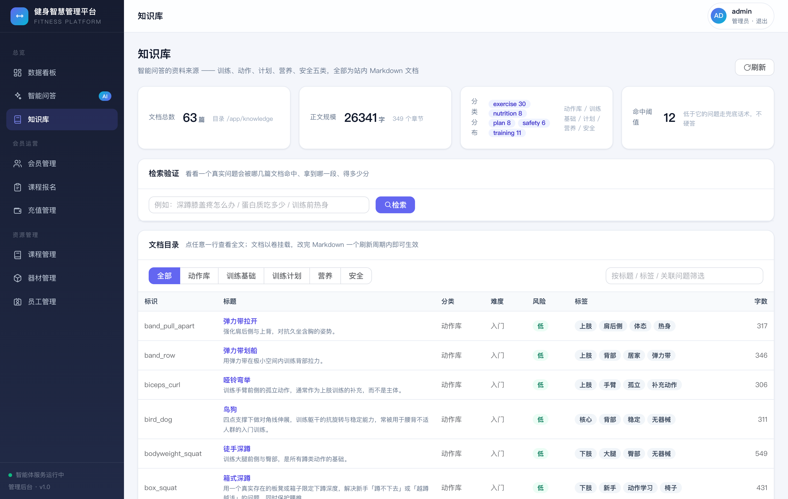
<figcaption>截图 13　知识库浏览页：文档总数、分类分布、命中阈值与文档目录</figcaption>
</figure>
<!--/SHOT-->

<!--SHOT:30-knowledge-search.png-->
<figure class="shot">
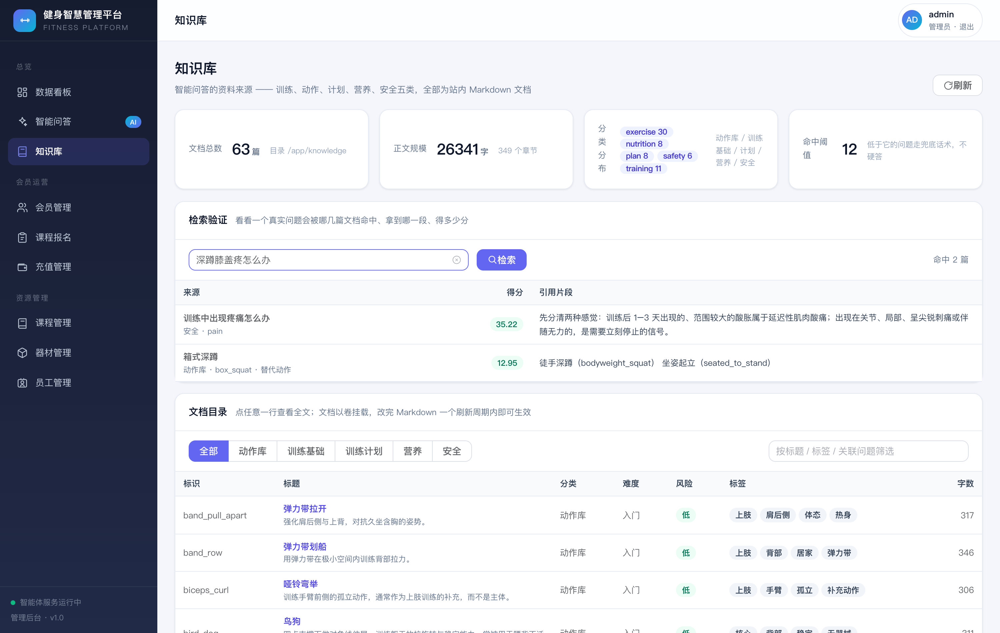
<figcaption>截图 14　检索验证：真实问题命中并给出得分与引用片段（可解释检索）</figcaption>
</figure>
<!--/SHOT-->


知识问答是**第二个出口**——意图不在白名单里时，先看知识库答不答得上来，答不上来才走兜底话术。整条链路设计成一个对用户"永不空手而归"的三段式降级：

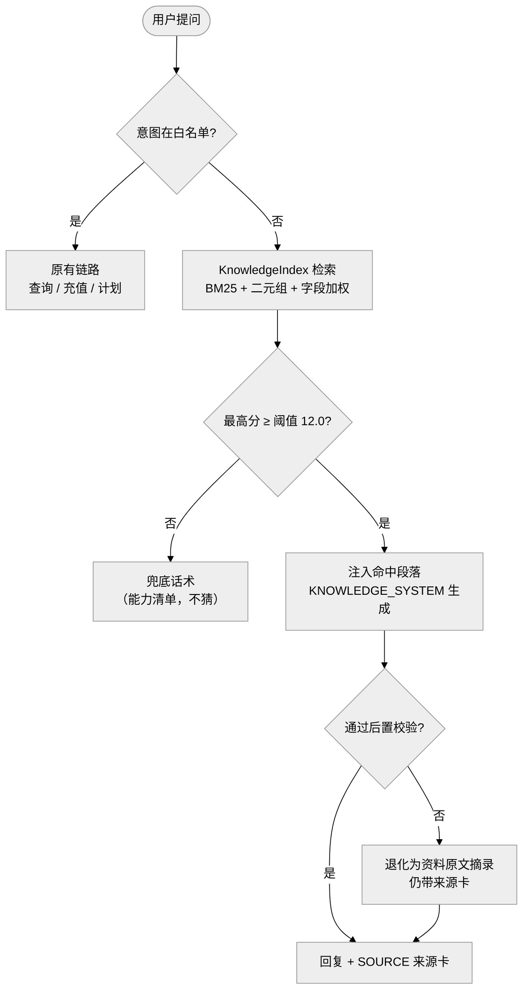

**第一段：检索（可解释）**。不引入向量库与 embedding 服务，用内存 BM25：中文二元组切分 + 字段加权（标题 / 标签 / 示例问句权重 ×3，正文 ×1）+ 短语命中加成（问句命中 +14、标题命中 +10）。检索结果里每一篇都带**命中段落与锚点**，所以"为什么答这个"永远讲得清，这是黑盒向量检索给不了的。

**第二段：生成（有约束）**。命中段落连同 `KNOWLEDGE_SYSTEM` 交给大模型组织语言，硬约束见 4.7.6，输出再经 `KnowledgeAnswerService` 后置校验（`violationOf`）：冒充已执行操作、编造业务数据、markdown 标题、超长（>460 字）、空内容——任一越界即丢弃。

**第三段：兜底（不空手）**。模型越界、超时、未配置密钥时，直接**退化为资料原文摘录**（`fromLlm=false`），仍附来源卡。也就是说：只要检索命中了，用户至少能拿到知识库里那一段原话，绝不会因为模型故障而得到一句"抱歉"。

> 阈值 12.0 是**实测标定**的结果，不是拍脑袋：正样本最低 16.06 分、负样本最高 8.93 分，取区间中点留足双侧裕度。标定脚本见 10.5。

### 4.9 会话历史与归属隔离

本轮把"服务端无状态"升级为"**服务端存历史、但请求仍自洽**"：历史落智能体**自己的库**（`fitness_ai`，见 5.7），会话标识 `sessionKey` 由服务端生成、随响应回给前端，下一轮带回来续上。这与原先"历史全靠前端回传"相比，换来的是刷新页面、换设备后历史不丢。

**归属怎么定？**绝不信任前端自报的身份，而是走一条可验证链：

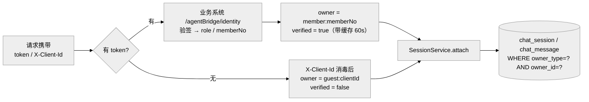

三个要点：

1. **身份来自验签，不来自自报**。会员端的 `token` 由业务系统签发（含 `memberNo`/`role`），智能体拿它去业务系统 `/agentBridge/identity` 校验，返回什么就是什么；无 `token` 的访客退化为浏览器本地 `clientId`（**非账号级**，`verified=false`）。
2. **越权校验落在数据访问层，不落在业务逻辑里**。`ChatStore` 的**每一条** SQL 都带 `owner_type=? AND owner_id=?`——即便前端拿别人的 `sessionKey` 来读或写，也命中不到任何行。这是"把安全做进查询"而不是"记得在每个分支里判断"。
3. **存不上不阻断对话**。存储不可用（库挂了、连不上）时容器照常启动（`initializationFailTimeout=-1`），本轮回答正常返回，只是 `sessionKey` 为空；恢复后自动续存（重试冷却 30s）。

> 设计取舍：会话库**自有 schema、不带 ORM、不带迁移框架**。理由是只维护两张表、且是"附属存储"形态——引入 JPA/EntityManager 与 Flyway 带来的协调成本大于收益。建表由 `SchemaInitializer` 在启动时 `IF NOT EXISTS` 自举。

---

## 5. 数据库设计

### 5.1 数据库概况

| 项 | 值 |
|---|---|
| 实例 | MySQL 8.0，utf8mb4 / utf8mb4_0900_ai_ci |
| 库名 | gym_management |
| 表数量 | 9 张（本轮**零新增表**，订单复用 recharge） |
| 引擎 | InnoDB，ROW_FORMAT=DYNAMIC |
| 初始化 | `doc/gym_management.sql` 挂载至 docker-entrypoint-initdb.d，仅首次启动导入 |

### 5.2 实体关系总览

只画实体与关系连线，不塞属性；属性在 5.3 逐实体单列。

```mermaid
%%{init: {'theme':'neutral','themeVariables':{'primaryColor':'#ffffff','primaryBorderColor':'#000000','lineColor':'#000000','primaryTextColor':'#000000','secondaryColor':'#ffffff','tertiaryColor':'#f5f5f5','fontFamily':'PingFang SC, Microsoft YaHei, sans-serif'}}}%%
erDiagram
  MEMBER ||--o{ CHECKIN : "产生签到"
  MEMBER ||--o{ RECHARGE : "拥有订单"
  MEMBER ||--o{ REGISTER : "发起报名"
  COURSE ||--o{ REGISTER : "被报名"
  EMPLOYEE ||--o{ COURSE : "授课"
  MANAGER ||--o{ COURSE : "管理"
  EMPLOYEE ||--o| MANAGER : "担任"
```

### 5.3 各实体 ER 图（逐实体单列）

#### 5.3.1 member（会员）

```mermaid
%%{init: {'theme':'neutral','themeVariables':{'primaryColor':'#ffffff','primaryBorderColor':'#000000','lineColor':'#000000','primaryTextColor':'#000000','secondaryColor':'#ffffff','tertiaryColor':'#f5f5f5','fontFamily':'PingFang SC, Microsoft YaHei, sans-serif'}}}%%
erDiagram
  MEMBER {
    int memberNo PK "会员编号 自增"
    varchar memberUsername "登录账号"
    varchar memberPassword "登录密码"
    varchar memberName "姓名"
    int memberAge "年龄"
    char memberGender "性别"
    varchar memberPhone UK "手机号 唯一索引"
    datetime cardTime "开卡时间"
    double memberHeight "身高 cm"
    double memberWeight "体重 kg"
    int cardClass "当前卡等级"
    int cardNextClass "目标卡等级"
    int memberIntegral "积分"
    int memberChange "账户余额"
    varchar personalizedSignature "个性签名"
    varchar memberPower "权限标识"
    varchar token "登录令牌"
  }
```

#### 5.3.2 recharge（充值流水 / 充值订单）

```mermaid
%%{init: {'theme':'neutral','themeVariables':{'primaryColor':'#ffffff','primaryBorderColor':'#000000','lineColor':'#000000','primaryTextColor':'#000000','secondaryColor':'#ffffff','tertiaryColor':'#f5f5f5','fontFamily':'PingFang SC, Microsoft YaHei, sans-serif'}}}%%
erDiagram
  RECHARGE {
    int rechargeNo PK "流水号 即订单号 自增"
    datetime rechargeDate "充值日期 建单取 CURDATE"
    varchar rechargeMethod "支付方式"
    int rechargeStatus "状态 0待支付 1已支付 2已取消"
    double rechargeMoney "金额"
    int memberNo FK "所属会员"
  }
```

#### 5.3.3 register（报名订单）

```mermaid
%%{init: {'theme':'neutral','themeVariables':{'primaryColor':'#ffffff','primaryBorderColor':'#000000','lineColor':'#000000','primaryTextColor':'#000000','secondaryColor':'#ffffff','tertiaryColor':'#f5f5f5','fontFamily':'PingFang SC, Microsoft YaHei, sans-serif'}}}%%
erDiagram
  REGISTER {
    int registerNo PK "报名编号"
    int courseNo FK "课程"
    int memberNo FK "会员"
  }
```

#### 5.3.4 course（课程）

```mermaid
%%{init: {'theme':'neutral','themeVariables':{'primaryColor':'#ffffff','primaryBorderColor':'#000000','lineColor':'#000000','primaryTextColor':'#000000','secondaryColor':'#ffffff','tertiaryColor':'#f5f5f5','fontFamily':'PingFang SC, Microsoft YaHei, sans-serif'}}}%%
erDiagram
  COURSE {
    int courseNo PK "课程编号"
    varchar courseName "课程名称"
    datetime courseTime "开课时间"
    varchar courseDuration "课时时长"
    double coursePrice "课程价格"
    varchar courseDesc "课程描述"
    int courseIntegral "赠送积分"
    int employeeNo FK "授课教练"
    int managerNo FK "归属经理"
  }
```

#### 5.3.5 employee（员工）

```mermaid
%%{init: {'theme':'neutral','themeVariables':{'primaryColor':'#ffffff','primaryBorderColor':'#000000','lineColor':'#000000','primaryTextColor':'#000000','secondaryColor':'#ffffff','tertiaryColor':'#f5f5f5','fontFamily':'PingFang SC, Microsoft YaHei, sans-serif'}}}%%
erDiagram
  EMPLOYEE {
    int employeeNo PK "员工编号"
    varchar employeeName "姓名"
    int employeeAge "年龄"
    varchar employeeGender "性别"
    varchar employeePhone "联系电话"
    datetime employeeTime "入职时间"
    text employeeMessage "备注"
    int employeeJob "岗位 1教练 2前台 3保洁 4经理"
  }
```

#### 5.3.6 manager（经理）

```mermaid
%%{init: {'theme':'neutral','themeVariables':{'primaryColor':'#ffffff','primaryBorderColor':'#000000','lineColor':'#000000','primaryTextColor':'#000000','secondaryColor':'#ffffff','tertiaryColor':'#f5f5f5','fontFamily':'PingFang SC, Microsoft YaHei, sans-serif'}}}%%
erDiagram
  MANAGER {
    int managerNo PK "经理编号"
    int employeeNo FK "对应员工"
  }
```

#### 5.3.7 checkin（签到）

```mermaid
%%{init: {'theme':'neutral','themeVariables':{'primaryColor':'#ffffff','primaryBorderColor':'#000000','lineColor':'#000000','primaryTextColor':'#000000','secondaryColor':'#ffffff','tertiaryColor':'#f5f5f5','fontFamily':'PingFang SC, Microsoft YaHei, sans-serif'}}}%%
erDiagram
  CHECKIN {
    int checkNo PK "签到编号"
    int memberNo FK "会员"
    datetime checkDate "签到时间"
  }
```

#### 5.3.8 equipment（器材）

```mermaid
%%{init: {'theme':'neutral','themeVariables':{'primaryColor':'#ffffff','primaryBorderColor':'#000000','lineColor':'#000000','primaryTextColor':'#000000','secondaryColor':'#ffffff','tertiaryColor':'#f5f5f5','fontFamily':'PingFang SC, Microsoft YaHei, sans-serif'}}}%%
erDiagram
  EQUIPMENT {
    int equipmentNo PK "器材编号"
    varchar equipmentName "器材名称"
    varchar equipmentLocation "摆放位置"
    int equipmentState "状态"
    varchar equipmentMessage "备注"
    varchar employeeJob "责任岗位"
  }
```

#### 5.3.9 admin（管理员）

```mermaid
%%{init: {'theme':'neutral','themeVariables':{'primaryColor':'#ffffff','primaryBorderColor':'#000000','lineColor':'#000000','primaryTextColor':'#000000','secondaryColor':'#ffffff','tertiaryColor':'#f5f5f5','fontFamily':'PingFang SC, Microsoft YaHei, sans-serif'}}}%%
erDiagram
  ADMIN {
    int adminNo PK "管理员编号"
    varchar adminAccount "账号"
    varchar adminPassword "密码"
    varchar token "令牌"
  }
```

### 5.4 订单语义：recharge 表的双重角色

本轮**未新增任何表**，把 recharge 复用为充值订单表，靠 `rechargeStatus` 区分：

| rechargeStatus | 语义 | 写入方 |
|---|---|---|
| 0 | 待支付订单 | agentBridge 建单（`insertPendingRecharge`，状态硬编码 0） |
| 1 | 已支付 | agentBridge 入账（`markRechargePaid`，条件 UPDATE） |
| 2 | 已取消 | 取消订单 |

- `rechargeNo` 自增主键天然作为**订单号**，对用户展示为"订单 9"。
- `rechargeDate` 建单时取 `CURDATE()`。
- 老数据（历史充值流水，rechargeMoney 直接到账）与本轮订单在状态字段上互不干扰。

### 5.5 索引与约束

| 表 | 约束/索引 | 说明 |
|---|---|---|
| member | PRIMARY KEY (memberNo) | 自增 |
| member | UNIQUE KEY (memberPhone) | 手机号唯一，防重复注册 |
| recharge | PRIMARY KEY (rechargeNo) | 自增，兼作订单号 |
| recharge | KEY (memberNo) | 按会员查流水 |
| 其余各表 | PRIMARY KEY (xxNo) | 各自自增主键 |
| 跨表 | 无数据库层外键 | 关系由应用层维护（原系统设计如此） |

### 5.6 数据字典（9 表全量）

> 字段说明与 5.3 的 ER 图一一对应，此处补充类型与实测行数。

| # | 表名 | 行数（实测） | 职责 |
|---|---|---|---|
| 1 | member | 12003 | 会员档案 + 账户余额/积分 |
| 2 | recharge | 10 | 充值流水 + 充值订单（复用） |
| 3 | register | 2 | 课程报名订单 |
| 4 | course | 1 | 课程 |
| 5 | employee | 3 | 员工 |
| 6 | manager | 1 | 经理 |
| 7 | checkin | 2 | 签到 |
| 8 | equipment | 1 | 器材 |
| 9 | admin | 1 | 管理员 |

字段明细见 5.3 各实体图（类型、主外键、语义均已标注），此处不重复展开。

### 5.7 智能体自有库 fitness_ai（本轮新增）

会话历史**不写业务库**——业务库是"会员资产"的事实来源，聊天记录属于智能体自身的运行数据，两者生命周期与备份策略都不同，混在一起会互相牵连。因此智能体在**同一个 MySQL 实例**上另建 schema `fitness_ai`，只放两张表，启动时由 `SchemaInitializer` 自举（`CREATE ... IF NOT EXISTS`），不参与业务的初始化脚本。

```mermaid
%%{init: {'theme':'neutral','themeVariables':{'primaryColor':'#ffffff','primaryBorderColor':'#000000','lineColor':'#000000','primaryTextColor':'#000000','secondaryColor':'#ffffff','tertiaryColor':'#f5f5f5','fontFamily':'PingFang SC, Microsoft YaHei, sans-serif'}}}%%
erDiagram
  CHAT_SESSION ||--o{ CHAT_MESSAGE : "一对多 · session_key"
  CHAT_SESSION {
    bigint session_id PK "自增"
    varchar session_key "对外会话标识 UUID"
    varchar owner_type "member / admin / guest"
    varchar owner_id "memberNo 或 clientId"
    varchar title "首句截断生成的标题"
    int message_count "消息条数，兼作下一 seq"
    datetime created_at
    datetime updated_at
  }
  CHAT_MESSAGE {
    bigint message_id PK "自增"
    varchar session_key FK "所属会话"
    varchar owner_type "冗余存归属，便于越权校验"
    varchar owner_id "冗余存归属"
    int seq "会话内顺序号"
    varchar role "user / assistant"
    text content "消息正文（截断至 4000 字）"
    varchar prompt_version "本条由哪个提示词版本生成"
    datetime created_at
  }
```

| 设计点 | 说明 |
|---|---|
| **归属冗余** | `chat_message` 也存 `owner_type/owner_id`，使越权校验无需回表 join，直接落进每条 SQL |
| **seq 单调** | 由 `chat_session.message_count` 自增而来，`FOR UPDATE` 行锁保证并发追加不乱序 |
| **标题** | 会话首句用户发言截断生成，用户可改名（rename 只改 title） |
| **限长** | 单条消息入库前截断至 4000 字（`maxMessageChars`），title 截断至 900 字（VARCHAR(1000) 留余量） |
| **清理** | `retentionDays=0` 表示永久保留；设正整数则定时清理超期会话（`purgeExpired`） |

> 索引：`chat_session` (owner_type, owner_id, updated_at) 支持"列出我的会话"；`chat_message` (session_key, seq) 支持"按序回放"。

---

## 6. 接口设计

### 6.1 暴露拓扑

```mermaid
%%{init: {'theme':'neutral','themeVariables':{'primaryColor':'#ffffff','primaryBorderColor':'#000000','lineColor':'#000000','primaryTextColor':'#000000','secondaryColor':'#ffffff','tertiaryColor':'#f5f5f5','fontFamily':'PingFang SC, Microsoft YaHei, sans-serif'}}}%%
flowchart LR
  FE["前端 api.js"] -->|"/api/** 剥前缀"| GYM["gym-backend :9090<br/>61 + 3 个接口"]
  FE -->|"/agent-api/** 剥前缀"| AG["fitness-agent :9091<br/>5 + 4 + 6 个接口"]
  AG -->|"内部 REST 直连"| GYM
```

### 6.2 智能体接口（5 个，经 /agent-api 反代）

| 方法 | 路径 | 入参 | 出参 | 用途 |
|---|---|---|---|---|
| POST | /api/qa/chat | messages[]、memberId、pending、sessionKey | ChatResponse（reply/slots/missing/cards/pending/status/sessionKey） | **对话主入口**，历史可落库续接 |
| GET | /api/qa/metadata | — | 性别/目标选项、llmConfigured | 能力元数据 |
| POST | /api/qa/fitness-plan | PlanRequest | PlanResponse | 表单式直接生成计划（兼容保留） |
| GET | /api/qa/pay/{orderNo} | orderNo | status/amount/balance | 电脑端轮询到账 |
| POST | /api/qa/pay/{orderNo}/confirm | orderNo | balance | 确认支付（演示为模拟支付） |

统一错误契约：参数校验 400（含字段明细）、资源不存在 404、上游不可用 502，由 GlobalExceptionHandler 收口为 ApiError 结构。

> 对话接口的**归属请求头**（可选，决定历史落到谁名下）：`token`（会员/管理员，经业务系统验签）与 `X-Client-Id`（访客浏览器标识）。二者皆无时本轮不落库。


### 6.3 业务系统接口（原 61 个，零改动）

| 模块 | 代表接口 | 数量 |
|---|---|---|
| MemberController | /getAllMember、/getMemberPassword、/getMemberChange、/updateMemberChangeByMemberNo、/memberExport… | 22 |
| AdminController | /getAdminPassword、/checkToken | 2 |
| CourseController | /getAllCourse、/addCourse… | 8 |
| RegisterController | /getAllRegister、/getRegisterByMemberNo、/addRegister… | 8 |
| EmployeeController | /getAllEmployee、/getAllCoach… | 8 |
| EquipmentController | /getAllEquipment… | 7 |
| RechargeController | /getRechargeByMemberNo、/addRechargeByMemberNo | 2 |
| CheckInController | /addCheckIn | 1 |
| ManagerController | /getAllManager | 1 |
| EchartsController | /echarts/getMemberBySeason、/echarts/getMemberSexByYear | 2 |

### 6.4 桥接薄接口（本轮新增 3 个，/agentBridge）

| 方法 | 路径 | 校验 | 幂等机制 |
|---|---|---|---|
| POST | /agentBridge/recharge/order | 金额 1–10000 整数、会员存在 | 建单即新流水 |
| GET | /agentBridge/recharge/order/{orderNo} | 订单存在 | 只读 |
| POST | /agentBridge/recharge/order/{orderNo}/pay | 订单待支付 | **条件 UPDATE** `WHERE rechargeStatus=0`，影响行数 0 即已支付，不重复加钱 |

### 6.5 智能体 → 业务系统的内部调用

| 场景 | 调用 |
|---|---|
| 查余额 | GET /getMemberChange?memberNo= |
| 查积分 | GET /getMemberIntegral?memberNo= |
| 查充值记录 | GET /getRechargeByMemberNo?memberNo= |
| 查课程报名 | GET /getRegisterByMemberNo?memberNo= |
| 读会员档案（计划用） | GET /getMemberByMemberNo?memberNo= |
| 建单 | POST /agentBridge/recharge/order |
| 查订单 | GET /agentBridge/recharge/order/{no} |
| 支付 | POST /agentBridge/recharge/order/{no}/pay |
| **校验身份** | GET /agentBridge/identity（携 token，返回 role/memberNo） |

### 6.6 会话历史接口（本轮新增 5 个，/api/qa/sessions）

| 方法 | 路径 | 入参 | 用途 |
|---|---|---|---|
| GET | /api/qa/sessions | 归属请求头 | 列出**我的**会话（按 updated_at 倒序） |
| POST | /api/qa/sessions | title?、归属请求头 | 新建空会话 |
| GET | /api/qa/sessions/{key}/messages | 归属请求头 | 按 seq 回放某会话消息 |
| POST | /api/qa/sessions/{key}/rename | title、归属请求头 | 改名 |
| DELETE | /api/qa/sessions/{key} | 归属请求头 | 删除（连同消息） |

所有接口的归属均由 `token`/`X-Client-Id` 解析，**且查询条件带归属**：拿别人的 `sessionKey` 调这些接口只会得到 404，不会泄露任何内容。

### 6.7 知识库接口（本轮新增 4 个，/api/knowledge）

| 方法 | 路径 | 入参 | 用途 |
|---|---|---|---|
| GET | /api/knowledge/stats | — | 文档总数、分类分布、阈值等概览 |
| GET | /api/knowledge/docs | category? | 文档目录（可按分类过滤） |
| GET | /api/knowledge/docs/{id} | id | 单篇全文 |
| GET | /api/knowledge/search | q、topK?、category? | **检索验证**：返回命中篇目、得分、锚点、段落、`bestScore`（便于排查"为什么没答上来"） |

知识库接口是**只读**的，既是产品能力（前端浏览页），也是运维探针（检索调试）。

---

## 7. 关键流程设计

### 7.1 时序图：一句话充值闭环（核心）
<!--SHOT:25-pay-done.png-->
<figure class="shot">
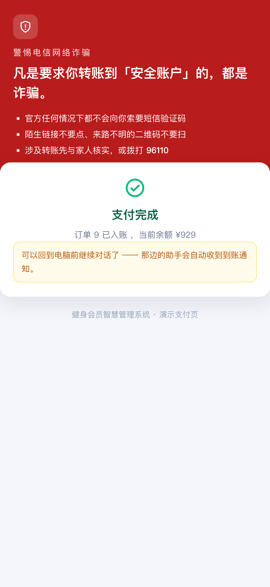
<figcaption>截图 15　模拟支付完成，页面返回当前余额</figcaption>
</figure>
<!--/SHOT-->

<!--SHOT:26-member-receipt.png-->
<figure class="shot">
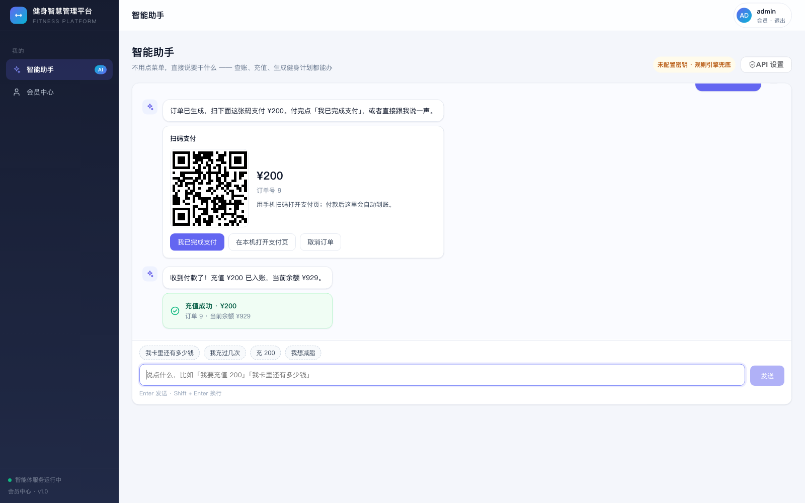
<figcaption>截图 16　电脑端 3 秒轮询自动发现到账并弹出回执卡</figcaption>
</figure>
<!--/SHOT-->


```mermaid
%%{init: {'theme':'neutral','themeVariables':{'primaryColor':'#ffffff','primaryBorderColor':'#000000','lineColor':'#000000','primaryTextColor':'#000000','secondaryColor':'#ffffff','tertiaryColor':'#f5f5f5','fontFamily':'PingFang SC, Microsoft YaHei, sans-serif'}}}%%
sequenceDiagram
  autonumber
  actor M as 会员
  participant W as 对话页前端
  participant A as fitness-agent
  participant G as gym-backend
  participant DB as MySQL
  participant P as 手机支付页

  M->>W: 「充 200」
  W->>A: POST /qa/chat（历史 + 待办 + memberNo）
  A->>A: 意图识别 RECHARGE · 金额 200
  A-->>W: 确认卡 CONFIRM（金额 + 当前余额）
  W->>A: 「确认」（种子词回传）
  A->>G: POST /agentBridge/recharge/order
  G->>DB: INSERT recharge(status=0)
  DB-->>G: 订单号
  G-->>A: orderNo
  A-->>W: 支付卡 PAY（含二维码内容）
  W->>P: 手机扫码打开 /pay/订单号
  P->>A: POST /qa/pay/{no}/confirm
  A->>G: POST /agentBridge/recharge/order/{no}/pay
  G->>DB: UPDATE ... WHERE status=0（幂等）
  G->>DB: UPDATE member 余额 += 金额
  G-->>A: PAID + 余额
  A-->>P: 支付完成
  loop 每 3 秒
    W->>A: GET /qa/pay/{no}
    A->>G: GET /agentBridge/recharge/order/{no}
    G-->>A: status
  end
  A-->>W: PAID
  W-->>M: 回执卡「充值成功 · 余额已更新」
```

### 7.2 时序图：健身计划生成（含降级）

```mermaid
%%{init: {'theme':'neutral','themeVariables':{'primaryColor':'#ffffff','primaryBorderColor':'#000000','lineColor':'#000000','primaryTextColor':'#000000','secondaryColor':'#ffffff','tertiaryColor':'#f5f5f5','fontFamily':'PingFang SC, Microsoft YaHei, sans-serif'}}}%%
sequenceDiagram
  autonumber
  actor U as 用户
  participant A as fitness-agent
  participant HP as HealthMetricsService
  participant L as LLM 服务
  participant R as 规则引擎

  U->>A: 我想减脂，男 30 岁 178cm 85kg
  A->>A: 槽位抽取（全部命中）
  A->>HP: 计算 BMI/BMR/体脂/TDEE/目标热量
  HP-->>A: 指标 + 来源标注（MEASURED/ESTIMATED）
  A->>L: chatJson（系统提示 + 结构化要求）
  alt LLM 可用且返回合法 JSON
    L-->>A: 计划文本（训练/饮食/注意事项）
    A-->>U: status=OK + 计划 + 计算证据
  else LLM 超时/未配置/JSON 非法
    A->>R: 规则引擎生成等效计划
    R-->>A: 计划
    A-->>U: status=DEGRADED + 计划 + 计算证据
  end
```

### 7.3 时序图：管理员边界（不猜会员）
<!--SHOT:13-agent-chat-guard.png-->
<figure class="shot">
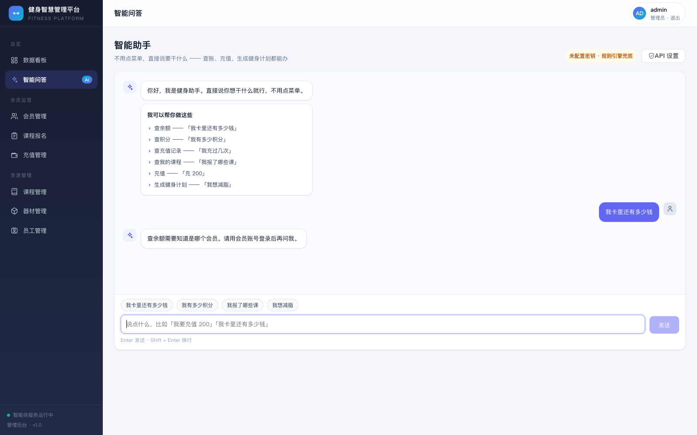
<figcaption>截图 17　管理员无会员上下文时被明确拒绝，验证「不猜目标会员」</figcaption>
</figure>
<!--/SHOT-->


```mermaid
%%{init: {'theme':'neutral','themeVariables':{'primaryColor':'#ffffff','primaryBorderColor':'#000000','lineColor':'#000000','primaryTextColor':'#000000','secondaryColor':'#ffffff','tertiaryColor':'#f5f5f5','fontFamily':'PingFang SC, Microsoft YaHei, sans-serif'}}}%%
sequenceDiagram
  autonumber
  actor AD as 管理员
  participant A as fitness-agent
  AD->>A: 查余额（无 memberId）
  A->>A: 检测 memberId 为空
  A-->>AD: 拒绝并引导「请用会员账号登录后再问」
  Note over A: 绝不猜测目标会员，杜绝代查代充
```

### 7.4 状态图：充值订单生命周期

```mermaid
%%{init: {'theme':'neutral','themeVariables':{'primaryColor':'#ffffff','primaryBorderColor':'#000000','lineColor':'#000000','primaryTextColor':'#000000','secondaryColor':'#ffffff','tertiaryColor':'#f5f5f5','fontFamily':'PingFang SC, Microsoft YaHei, sans-serif'}}}%%
stateDiagram-v2
  direction LR
  [*] --> 待支付 : 对话确认充值，建单 status=0
  待支付 --> 已支付 : 支付确认（条件 UPDATE，幂等）
  待支付 --> 已取消 : 用户取消
  待支付 --> 待支付 : 重复支付请求被幂等拒绝
  已支付 --> [*]
  已取消 --> [*]
```

### 7.5 状态图：会员卡等级

```mermaid
%%{init: {'theme':'neutral','themeVariables':{'primaryColor':'#ffffff','primaryBorderColor':'#000000','lineColor':'#000000','primaryTextColor':'#000000','secondaryColor':'#ffffff','tertiaryColor':'#f5f5f5','fontFamily':'PingFang SC, Microsoft YaHei, sans-serif'}}}%%
stateDiagram-v2
  direction LR
  [*] --> 未开卡
  未开卡 --> 普通会员卡 : 注册并开卡 cardClass=1
  普通会员卡 --> VIP会员卡 : 充值累计达标 cardClass=2
  VIP会员卡 --> 已过期 : 有效期届满
  已过期 --> 普通会员卡 : 续费充值
```

### 7.6 活动图：会员对话主流程

```mermaid
%%{init: {'theme':'neutral','themeVariables':{'primaryColor':'#ffffff','primaryBorderColor':'#000000','lineColor':'#000000','primaryTextColor':'#000000','secondaryColor':'#ffffff','tertiaryColor':'#f5f5f5','fontFamily':'PingFang SC, Microsoft YaHei, sans-serif'}}}%%
flowchart TD
  A([开始]) --> B{已登录?}
  B -- 否 --> C["手机号 + 密码登录"]
  C --> D{校验通过?}
  D -- 否 --> C
  D -- 是 --> E["进入对话页<br/>memberNo 由登录态锁定"]
  B -- 是 --> E
  E --> F{用户意图}
  F -- 查询 --> G["调业务系统只读接口<br/>卡片/文本回复"]
  F -- 充值 --> H["确认卡 → 订单 → 二维码"]
  H --> I{扫码支付?}
  I -- 是 --> J["支付页 → 幂等入账 → 回执"]
  I -- 否 --> K["「我付好了」→ 查订单状态"]
  K --> J
  F -- 计划 --> L["槽位抽取 → 计算 → 计划卡"]
  F -- 听不懂 --> M["能力清单（不猜）"]
  G --> N([继续对话])
  J --> N
  L --> N
  M --> N
```

### 7.7 活动图：支付页（手机端）

```mermaid
%%{init: {'theme':'neutral','themeVariables':{'primaryColor':'#ffffff','primaryBorderColor':'#000000','lineColor':'#000000','primaryTextColor':'#000000','secondaryColor':'#ffffff','tertiaryColor':'#f5f5f5','fontFamily':'PingFang SC, Microsoft YaHei, sans-serif'}}}%%
flowchart TD
  A([扫码进入 /pay/订单号]) --> B["公开路由放行（无登录态）"]
  B --> C["读取订单"]
  C --> D{订单存在?}
  D -- 否 --> E["错误提示"]
  D -- 是 --> F{状态?}
  F -- 已支付 --> G["显示支付完成 + 余额"]
  F -- 待支付 --> H["顶部反电诈警示（大字 96110）"]
  H --> I["订单信息 + 模拟支付按钮"]
  I --> J["确认支付"]
  J --> K["幂等入账"]
  K --> L["支付完成 + 当前余额"]
  L --> M([用户回电脑看回执])
```

### 7.8 时序图：知识问答（RAG 三段式）

一次"深蹲膝盖疼怎么办"的完整链路：意图未命中 → 检索命中 → 生成（含越界退化）→ 落库 → 带来源卡返回。

```mermaid
%%{init: {'theme':'neutral','themeVariables':{'primaryColor':'#ffffff','primaryBorderColor':'#000000','lineColor':'#000000','primaryTextColor':'#000000','secondaryColor':'#ffffff','tertiaryColor':'#f5f5f5','fontFamily':'PingFang SC, Microsoft YaHei, sans-serif'}}}%%
sequenceDiagram
  autonumber
  participant FE as 前端
  participant CS as ChatService
  participant KI as KnowledgeIndex
  participant KA as KnowledgeAnswerService
  participant LLM as 大模型
  participant SS as SessionService
  participant DB as fitness_ai

  FE->>CS: POST /qa/chat（问题 + 归属请求头）
  CS->>CS: IntentRouter 未命中白名单
  CS->>KI: search(问题)
  KI-->>CS: hits（id/得分/锚点/段落）
  alt 最高分 < 12.0
    CS-->>FE: 兜底话术 + 能力清单
  else 命中
    CS->>KA: answer(cfg, 问题, hits)
    KA->>LLM: KNOWLEDGE_SYSTEM + 命中段落
    alt 输出越界 / 超时 / 无密钥
      KA-->>CS: 退化为资料原文摘录（fromLlm=false）
    else 通过校验
      LLM-->>KA: 组织好的回答
      KA-->>CS: Answer + promptVersion=kb-v1
    end
    CS->>SS: attach(响应, 归属)
    SS->>DB: appendTurn（WHERE owner=当前归属）
    SS-->>CS: sessionKey
    CS-->>FE: 回复 + SOURCE 来源卡 + sessionKey
  end
```

### 7.9 时序图：会话落库与归属隔离

```mermaid
%%{init: {'theme':'neutral','themeVariables':{'primaryColor':'#ffffff','primaryBorderColor':'#000000','lineColor':'#000000','primaryTextColor':'#000000','secondaryColor':'#ffffff','tertiaryColor':'#f5f5f5','fontFamily':'PingFang SC, Microsoft YaHei, sans-serif'}}}%%
sequenceDiagram
  autonumber
  participant FE as 前端
  participant SR as SessionService / OwnerResolver
  participant GYM as 业务系统
  participant DB as fitness_ai

  Note over FE,DB: 场景一：会员带 token 对话（可验证归属）
  FE->>SR: 请求携带 token
  SR->>GYM: /agentBridge/identity（验签）
  GYM-->>SR: role=member, memberNo=1001
  SR->>DB: 会话/消息写入 WHERE owner_type='member' AND owner_id='1001'
  SR-->>FE: sessionKey

  Note over FE,DB: 场景二：访客无 token（浏览器本地隔离）
  FE->>SR: 请求携带 X-Client-Id
  SR->>SR: 消毒为非 [A-Za-z0-9_-] 外的空串后作为 owner_id
  SR->>DB: 写入 WHERE owner_type='guest' AND owner_id=clientId
  SR-->>FE: sessionKey

  Note over FE,DB: 场景三：越权访问（拿别人的 sessionKey）
  FE->>SR: GET /sessions/{他人的key}/messages
  SR->>DB: SELECT ... WHERE session_key=? AND owner_type=? AND owner_id=?
  DB-->>SR: 0 行
  SR-->>FE: 404（不泄露任何内容）
```

---

## 8. 部署设计

### 8.1 容器清单

| 服务 | 镜像 | 端口 | 依赖 | 健康检查 |
|---|---|---|---|---|
| fitness-web | fitness-web:1.0（nginx:1.25-alpine） | 8088→80 | gym-backend、fitness-agent 启动 | wget 首页 |
| fitness-agent | fitness-agent:1.0（多阶段：Maven17→JRE17） | 9091→9091 | mysql healthy、gym-backend 启动 | curl /actuator/health |
| gym-backend | gym-backend:1.0（多阶段：Maven8→JRE8） | 9090→9090 | mysql healthy | — |
| gym-mysql | mysql:8.0 | 13306→3306 | — | mysqladmin ping |

### 8.2 网络与数据卷

| 项 | 值 |
|---|---|
| 网络 | fitness-net（bridge），容器间以服务名互访 |
| 数据卷 | gym-mysql-data → /var/lib/mysql |
| 初始化 | ./gym-management-system/doc/gym_management.sql 只读挂载 |
| 知识库挂载 | ./fitness-agent/knowledge → /app/knowledge**:ro**（只读——知识库是内容资产，不应被运行中的容器改写；改 Markdown 后 60s 内自动重建索引，无需重建镜像） |
| 会话库 | 无需额外挂载：`fitness_ai` 建在同一个 MySQL 实例上，随 gym-mysql-data 一起持久化 |

### 8.3 环境变量

| 变量 | 默认 | 说明 |
|---|---|---|
| DEEPSEEK_API_KEY | 空（项目根 .env 注入） | LLM 密钥；空则智能体降级规则引擎 |
| FITNESS_LLM_BASE_URL | https://api.deepseek.com | OpenAI 兼容地址；实际部署由项目根 `.env` 覆盖为内网 vLLM 平台（地址属内网资产，不入库） |
| FITNESS_LLM_MODEL | deepseek-v4-flash | 模型名 |
| GYM_BASE_URL | http://gym-backend:9090 | 业务系统内网地址 |
| SPRING_DATASOURCE_URL | jdbc:mysql://mysql:3306/... | 业务库连接 |
| FITNESS_KB_ENABLED | true | 知识库总开关（关掉则知识问答不可用，其余不受影响） |
| FITNESS_KB_DIR | /app/knowledge | 知识库目录（卷挂载点） |
| FITNESS_KB_MIN_SCORE | 12.0 | 命中阈值（标定值，见 10.5） |
| FITNESS_KB_RELOAD_SECONDS | 60 | 热更新周期（秒），≤0 关闭 |
| FITNESS_DB_URL | jdbc:mysql://mysql:3306/fitness_ai?... | 会话库连接（**独立 schema**） |
| FITNESS_DB_USERNAME / PASSWORD | root / 1234 | 会话库账号 |
| FITNESS_CHAT_RETENTION_DAYS | 0 | 会话保留天数，0 表示永久 |

### 8.4 启动与运维

```bash
docker compose up -d --build     # 一键启动（无密钥也能跑，自动降级）
docker compose ps                # 健康状态
docker compose logs -f fitness-agent   # 对话/降级日志
docker compose build fitness-web && docker compose up -d fitness-web   # 改前端后重建
docker compose down              # 停止（-v 连数据卷一起删）
```

### 8.5 访问入口
<!--SHOT:15-members.png-->
<figure class="shot">
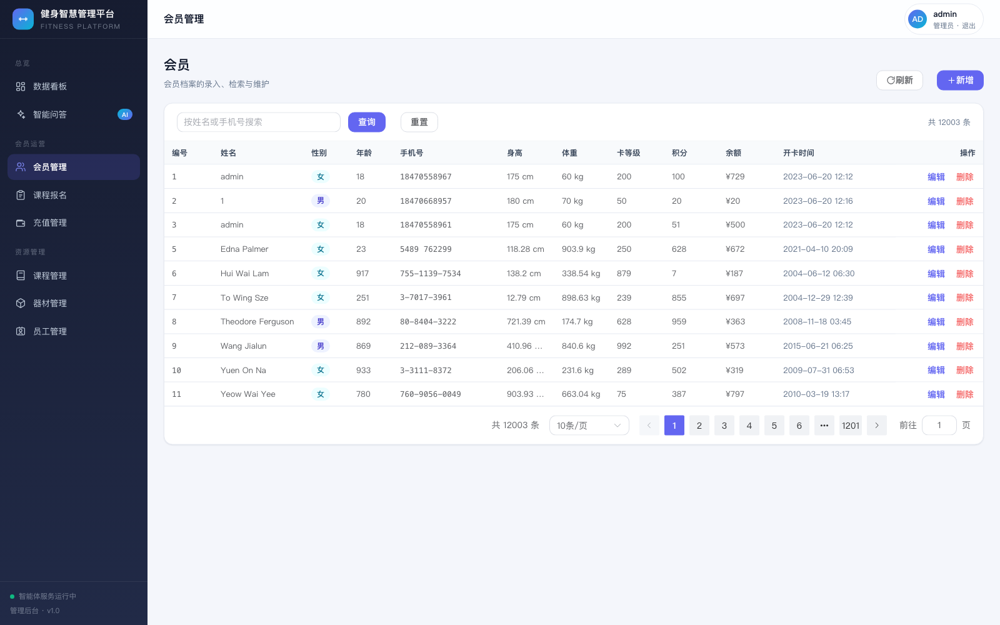
<figcaption>截图 18　后台·会员管理：会员台账</figcaption>
</figure>
<!--/SHOT-->

<!--SHOT:16-recharge.png-->
<figure class="shot">
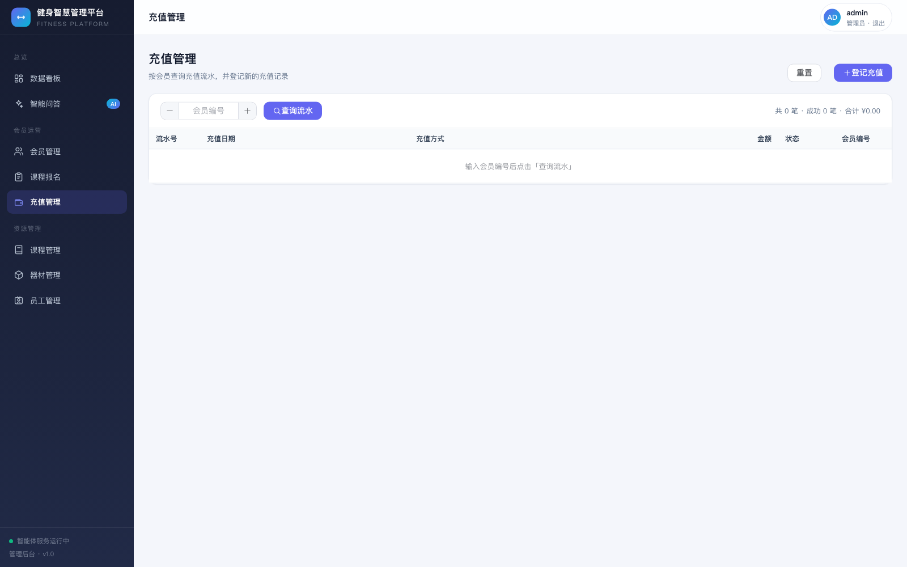
<figcaption>截图 19　后台·充值管理：充值流水，与对话产生的订单互不干扰</figcaption>
</figure>
<!--/SHOT-->

<!--SHOT:17-courses.png-->
<figure class="shot">
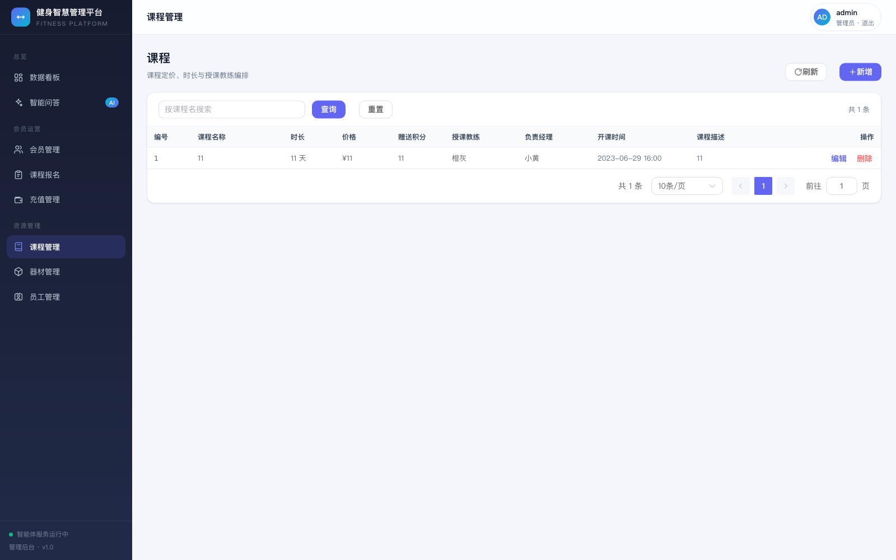
<figcaption>截图 20　后台·课程管理：课程台账</figcaption>
</figure>
<!--/SHOT-->

<!--SHOT:18-equipment.png-->
<figure class="shot">
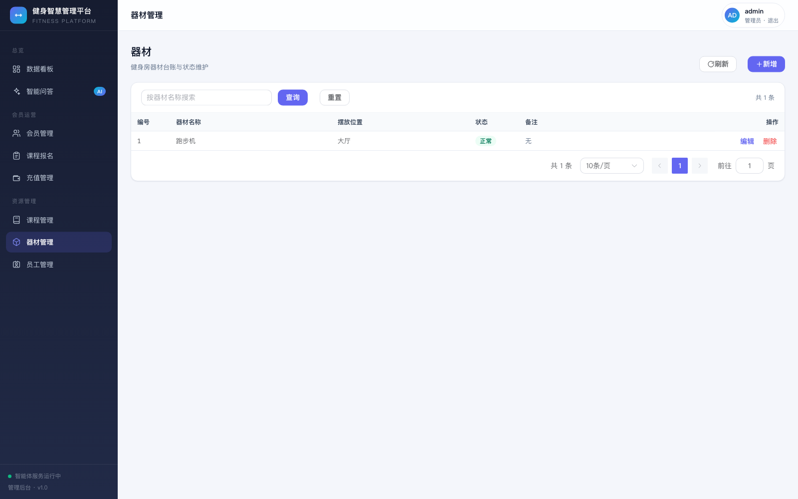
<figcaption>截图 21　后台·器材管理：器材台账</figcaption>
</figure>
<!--/SHOT-->

<!--SHOT:19-employees.png-->
<figure class="shot">
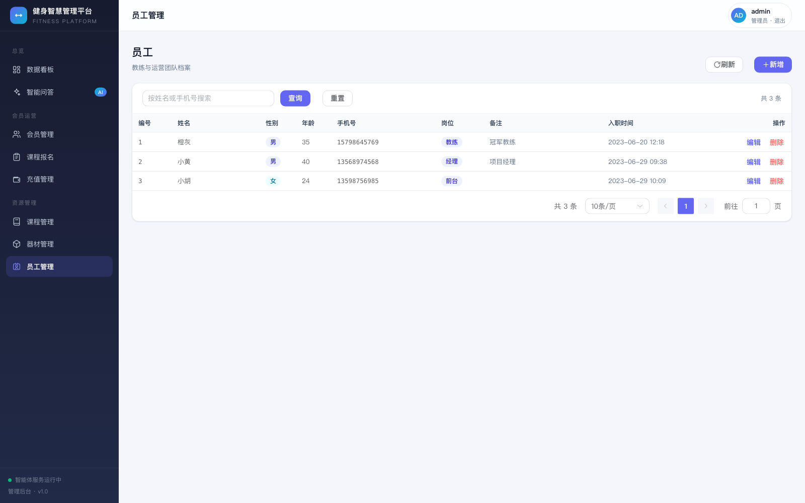
<figcaption>截图 22　后台·员工管理：员工台账</figcaption>
</figure>
<!--/SHOT-->

<!--SHOT:22-registers.png-->
<figure class="shot">
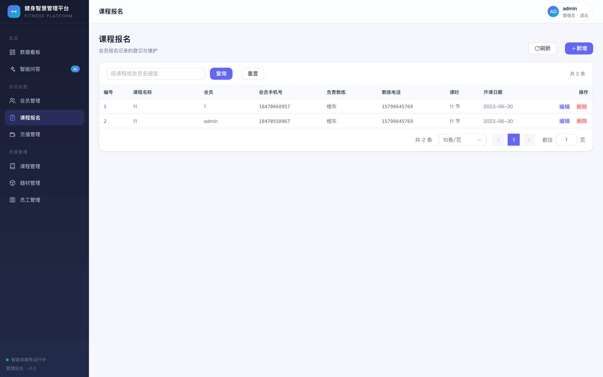
<figcaption>截图 23　后台·课程报名：报名台账</figcaption>
</figure>
<!--/SHOT-->

<!--SHOT:28-member-center.png-->
<figure class="shot">
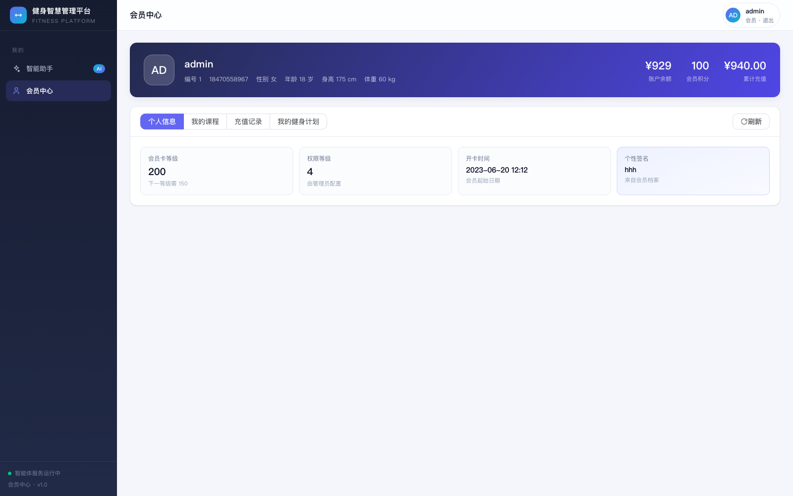
<figcaption>截图 24　会员中心：对话之外保留的传统入口，作为兜底</figcaption>
</figure>
<!--/SHOT-->


| 入口 | 地址 |
|---|---|
| 统一前端 | http://localhost:8088 |
| 业务后端直连 | http://localhost:9090 |
| 智能体直连 | http://localhost:9091 |
| MySQL | localhost:13306（root / 1234） |

---

## 9. 安全设计

### 9.1 威胁与对策

| 威胁 | 对策 | 落点 |
|---|---|---|
| 密钥泄露 | LLM Key 只存浏览器、随请求头下发、日志脱敏、服务端不落库 | LlmConfig / api.js |
| 重复支付 | 条件 UPDATE 幂等（WHERE status=0），影响行数为 0 不加钱 | AgentBridgeMapper.markRechargePaid |
| 越权代充代查 | 会员操作锁定登录态 memberNo；管理员无上下文一律拒绝 | ChatService / 前端锁定 |
| 伪造归属 | 会话归属来自 `token` **验签**（业务系统签发），不信任前端自报的身份 | OwnerResolver / AgentBridgeController.identity |
| 会话越权读取 | **每条** SQL 都带 `owner_type=? AND owner_id=?`；拿他人 `sessionKey` 只得 404 | ChatStore（owned / listSessions / appendTurn / delete…） |
| 访客 ID 注入 | `X-Client-Id` 只保留 `[A-Za-z0-9_-]`，其余字符剔除后作为 owner_id | OwnerResolver.sanitize |
| 知识库被改 | 卷以 `:ro` 只读挂载；语料另有启动期规范校验（front matter / 违禁词） | docker-compose / validate_knowledge.py |
| 扫码诈骗 | 支付页顶部反电诈大字警示 + 96110 + 三条提醒 | PayPage |
| 金额篡改 | 服务端二次校验金额范围 1–10000 整数 | AgentBridgeService |
| 注入 | MyBatis 参数化（#{}），无字符串拼接 SQL | 全部 Mapper |

### 9.2 遗留风险（原系统自带，未在本轮范围）

- JWT 密钥硬编码、无接口级鉴权拦截（仅前端路由守卫）；
- 登录接口无防爆破限制；
- 密码单表明文存储。

> 上述属原项目工程质量范畴，见附录 B。

**本轮归属隔离的设计边界**（明确说清"防住了什么、没防住什么"）：

- 会员/管理员的归属是**可验证**的（token 验签），越权读写他人的会话在数据层即被拦下；
- 访客归属是 `verified=false` 的**浏览器本地标识**，属"同一浏览器内的隔离"，**不是账号级安全边界**——清掉本地存储即换新身份，这是访客场景的固有性质，不宣称更强的保证。

---

## 10. 测试与验证（2026-10-11 实测）

### 10.1 意图识别测试（intent_test.py，16 单轮 + 多轮 + 边界）

| 用例组 | 数量 | 结果 |
|---|---|---|
| 单轮意图（含"充值记录"掩蔽、"充两百"中文数字、余额/积分/课程查询、签到未开通、听不懂兜底） | 16 | 全部通过 |
| 多轮充值（追问金额 → 确认 → 建单 → 轮询到账 → 回执） | 5 步 | 全部通过，余额 529→729 |
| 中途取消（算了） | 2 步 | 通过，待办正确清空 |
| 管理员边界（无会员上下文拒绝充值/查余额） | 2 | 通过 |

### 10.2 端到端截图验证（24 张，零 console/pageerror）

| 截图 | 验证点 |
|---|---|
| 12-agent-chat-idle / 20-member-agent-idle | 对话页首屏问候 + 能力清单 + 快捷指令 |
| 13-agent-chat-guard | 管理员无会员上下文被正确拒绝 |
| 14-agent-chat-plan | 复合话填满槽位，计划 + 计算证据渲染 |
| 21 / 22 / 23 | 余额查询 → 确认卡 → 二维码卡 |
| 24 / 25 | 手机支付页（反电诈警示）→ 支付完成 |
| 26 | 3s 轮询自动弹出回执卡 |
| 27 | 充值记录 LIST 卡含真实订单 |
| **29-knowledge-browse** | **知识库浏览页**：文档总数 63、正文字数、分类分布、命中阈值、文档目录与筛选 |
| **30-knowledge-search** | **检索验证**：真实问题命中 2 篇（35.22 / 12.95 分），含来源、得分、引用片段 |
| **31-agent-knowledge-answer** | **知识问答**：回答内联标注来源 + 底部"参考来源"卡；左侧会话侧栏记录本轮会话 |
| **32-agent-session-sidebar** | **历史持久化**：同一会话累计 5 条、侧栏预览随之更新，证明历史已落库续接 |

新页面截图由 `tools/screenshots_v21.py` 驱动（Playwright + 本机 Edge），管理员与会员两条路径全覆盖，零 console/pageerror。

### 10.3 数据核验（真实 COUNT）

| 表 | 行数 |
|---|---|
| member | 12003 |
| recharge | 10（含本轮产生的订单） |
| register / checkin | 2 / 2 |
| course / equipment / employee / manager / admin | 1 / 1 / 3 / 1 / 1 |

### 10.4 资金闭环核验

| 步骤 | 余额 |
|---|---|
| 初始 | 129 |
| 第 1 次充值 200 到账 | 329 |
| 第 2 次充值 200 到账 | 529 |
| 测试轮充值 200 | 729 |
| 截图轮充值 200 | 929 |
| 幂等验证 | 重复支付不重复加钱（条件 UPDATE） |

### 10.5 知识检索质量与阈值标定（knowledge_test.py，34 项）

| 用例组 | 数量 | 判据 | 结果 |
|---|---|---|---|
| A. 正样本 hit@3 | 26 | 期望文档出现在前 3 篇内 | **26/26 命中** |
| B. 负样本 | 8 | 最高分必须低于阈值（即"答不上来"） | **8/8 正确拒答** |
| 阈值标定 | — | 正样本最低分 > 阈值 > 负样本最高分 | 16.06 > 12.0 > 8.93 ✓ |

覆盖训练基础、动作要领、营养、安全四类；负样本刻意包含"会员卡什么时候到期""我什么时候能退款"这类**含"什么时候"但业务无关**的句子，用来压检索器的误命中。

**标定结果**：正样本最低 **16.06**（"最近太累了练不动怎么办"），负样本最高 **8.93**（"帮我订一张去北京的机票"），间隔 **7.13**。阈值取 **12.0**（区间中点），双侧裕度均超 3.9 分：

```bash
python3 tools/knowledge_test.py     # 打 http://localhost:8088/agent-api
```

> 本轮修过的两个真问题（都靠这套用例压出来）：① 中文二元组把「什么/么时/时候」这类纯虚字组合当成了词，罕见垃圾词拿到高 IDF 导致误命中——已在分词层过滤虚字；② 检索只注入命中段落、未给"要点"，模型答"资料里没写时长"——已改为注入要点+段落。

### 10.6 会话持久化与用户隔离（session_test.py，30 项）

| 场景 | 判据 | 结果 |
|---|---|---|
| 落库 | 对话后历史写入 `fitness_ai`，`sessionKey` 回传 | 通过 |
| 回放 | 按 `sessionKey` 取回消息，顺序与内容一致 | 通过 |
| 访客隔离 | 访客 A、B 各自只见自己的会话 | 通过 |
| 越权读 | B 拿 A 的 `sessionKey` 取消息 → 404 | 通过 |
| 越权写 | B 对 A 的会话改名/删除 → 不生效 | 通过 |
| 存储概览 | `/_storage` 显示 sessions/messages 计数与可用性 | 通过 |
| 降级 | 存储不可用时本轮仍返回、`sessionKey` 为空 | 通过 |

```bash
python3 tools/session_test.py       # 验证"历史存没存、别人看不看得到"
```

### 10.7 回归汇总（三套 198 项断言，全绿）

| 套件 | 断言数 | 覆盖 |
|---|---|---|
| intent_test.py | 16 + 多轮 | 意图路由（含新增知识问答分支） |
| prompt_test.py | 134 | 计划生成 + 兜底话术（含 kb 提示词） |
| knowledge_test.py | 34 | 检索命中率 + 阈值标定 |
| session_test.py | 30 | 持久化 + 用户隔离 |

> 本轮新增能力（知识库、会话、隔离）**未破坏原有四类查询、充值闭环与计划生成**——三套既有回归与两套新回归同时通过。

---

<!--THESIS-TEST-BEGIN-->
## 11. 系统测试报告（黑盒＋白盒）

> 本章全部数字与用例记录由 `tools/test_suite_v21.py` 实跑产出，存于 `docs/test-report-data.json`，再由此渲染成文——报告中没有一个数字是人工誊抄的。

### 11.1 测试概述

本轮在既有系统上新增三项能力：**轻量知识库（RAG 问答）**、**对话历史持久化**、**用户数据隔离**。测试要回答三个具体问题：

1. 新能力在真实链路上是否可用——知识问答能否命中、历史能否落库续接、隔离能否拦住越权；
2. 新能力是否破坏了原有能力——四类查询、充值闭环、计划生成是否仍然正确；
3. 关键设计约束是否真的生效——归属校验是否落在数据访问层、建表是否幂等、存储不可用时是否降级而不阻断。

| 准则 | 要求 |
| --- | --- |
| 功能用例 | 全部通过；涉及资金的用例以**余额精确变化**为准（不允许「看起来成功」） |
| 隔离用例 | 越权读返回 404、越权写不改变数据；不允许「没有报错」就算通过 |
| 结构用例 | 静态约束逐条命中；动态用例有可复现证据（EXPLAIN / 行数比对 / 容器状态） |
| 界面验证 | 全流程零 console 错误、零 pageerror；关键页面留截图证据 |
| 回归 | 既有四套回归（intent / prompt / knowledge / session）保持全绿 |


### 11.2 测试环境

| 角色 | 组件 | 端口 | 职责 |
| --- | --- | --- | --- |
| 统一入口 | fitness-web（nginx） | http://localhost:8088 | 前端 + 同源反向代理 |
| 业务后端 | gym-backend（SpringBoot 2.7 / Java 8） | :9090 | 会员/课程/器材/员工/报名/充值/看板 |
| 智能体 | fitness-agent（SpringBoot 3.2 / Java 17） | :9091 | 对话 / 计划 / 知识问答 / 会话 |
| 数据库 | MySQL 8（gym-mysql） | localhost:13306 | 业务库 gym_management + 智能体库 fitness_ai |
| 大模型 | 内网 vLLM（deepseek-v4-flash） | OpenAI 兼容协议 | 仅负责组织语言，不做数值计算 |

| 运行态观测项 | 取值 | 来源 |
| --- | --- | --- |
| 知识库文档总数 | 63 | GET /agent-api/knowledge/stats |
| 正文字数 / 章节数 | 26341 / 349 | 同上 |
| 命中阈值 minScore | 12.0 | 同上（标定见 11.3） |
| 热更新周期 | 60 秒 | 同上 |
| 会话存储可用性 | 可用 | GET /agent-api/qa/sessions/_storage |
| 会话 / 消息行数 | 52 / 116 | 同上 |


### 11.3 测试策略与方法

**黑盒**：用例只通过 REST 接口驱动，不关心内部实现，与用户真实使用路径一致。综合运用四种方法：

| 方法 | 在本轮的应用 | 典型用例 |
| --- | --- | --- |
| 等价类划分 | 把输入划分为有效/无效类，每类取代表值 | 金额合法（1–10000）与非法（0、10001）；身份（会员/管理员/访客） |
| 边界值分析 | 取区间端点与越界点 | BB-18 金额 0 与 10001 被拒 |
| 场景法 | 按真实业务流程串成端到端场景 | BB-11 → BB-12 → BB-14 充值闭环；BB-28 → BB-30 历史落库与回放 |
| 错误推测 | 凭经验针对高风险点设计反例 | 「充值记录」是否会误触发充值；「会员卡什么时候到期」是否会误命中知识库 |

**白盒**：用例落在「设计中明确承诺的约束」上，而不是凑覆盖率，分静态与动态两类：

| 方法 | 做法 | 典型用例 |
| --- | --- | --- |
| 静态结构审查 | 读源码断言约束存在且无遗漏 | WB-01 归属条件、WB-02 幂等建表、WB-11 后置校验、WB-13 提示词版本 |
| 动态结构验证 | 查数据库、看执行计划、比对行数 | WB-05/WB-06 索引命中、WB-15 越权写入行数不变 |
| 路径覆盖（降级路径） | 构造异常环境，专门走降级分支 | WB-16 故意的坏数据库地址，验证「存储不可用仍可对话」 |
| 变更触发验证 | 改动输入后观察系统行为是否按设计自适应 | WB-17 新增文档后索引自动重建（热更新） |

> 编号规则：`BB-xx` 为黑盒用例，`WB-xx` 为白盒用例；编号即执行顺序。全部用例由 `tools/test_suite_v21.py` 执行，原始记录见 `docs/test-report-data.json`。

### 11.4 黑盒测试用例与执行结果（44 条）

#### 11.4.1 黑盒执行汇总

| 测试模块 | 用例数 | 通过 | 失败 | 结论 |
| --- | --- | --- | --- | --- |
| 意图路由 | 10 | 10 | 0 | 全部通过 |
| 充值闭环 | 8 | 8 | 0 | 全部通过 |
| 计划生成 | 6 | 6 | 0 | 全部通过 |
| 知识问答 | 4 | 4 | 0 | 全部通过 |
| 会话持久化 | 6 | 6 | 0 | 全部通过 |
| 用户隔离 | 6 | 6 | 0 | 全部通过 |
| 接口与异常 | 4 | 4 | 0 | 全部通过 |
| **合计** | **44** | **44** | **0** | **通过率 100.0%** |

#### 11.4.2 意图路由（10 条）

意图路由是对话系统正确性的前提：判错意图，后面全错。本组专门覆盖易混表达与权限边界。

| 编号 | 用例 / 前置条件 / 操作步骤 | 预期结果 | 实际结果 | 结论 |
| --- | --- | --- | --- | --- |
| BB-01 | **充值记录判定为查询而非发起充值**<br>前置：会员已登录（memberId=1）<br>步骤：发送「充值记录」 | 返回 LIST 卡（充值记录），不出现 CONFIRM/PAY 卡 | HTTP 200，卡片=['LIST'] | 通过 |
| BB-02 | **口语化余额查询**<br>前置：会员已登录<br>步骤：发送「我卡里还有多少钱」 | 回复含余额数值，不出现确认卡 | HTTP 200，reply=你卡里还有 ¥2229。 | 通过 |
| BB-03 | **积分查询**<br>前置：会员已登录<br>步骤：发送「我有多少积分」 | 回复含积分数值或积分说明 | HTTP 200，reply=你目前有 100 积分。 | 通过 |
| BB-04 | **课程报名查询**<br>前置：会员已登录<br>步骤：发送「我报了哪些课」 | 返回课程相关回复（列表卡或文本） | HTTP 200，cards=['LIST']，reply=你已报名 1 门课程： | 通过 |
| BB-05 | **中文数字金额「充两百」解析为 200**<br>前置：会员已登录<br>步骤：发送「充两百」 | 确认卡金额 = 200 | HTTP 200，确认卡金额=200 | 通过 |
| BB-06 | **未识别语句走兜底且给出能力清单**<br>前置：会员已登录<br>步骤：发送「今天天气怎么样」 | 返回能力清单卡（NOTICE），不猜测执行业务 | HTTP 200，cards=['NOTICE'] | 通过 |
| BB-07 | **管理员无会员上下文拒绝代查**<br>前置：memberId 置空（管理员场景）<br>步骤：发送「我卡里还有多少钱」 | 明确要求用会员账号，不返回任何会员数据 | HTTP 200，reply=查余额需要知道是哪个会员。请用会员账号登录后再问我。 | 通过 |
| BB-08 | **管理员无会员上下文拒绝代充**<br>前置：memberId 置空<br>步骤：发送「我要充值200」 | 明确拒绝并说明需会员账号，不生成任何订单 | HTTP 200，cards=[]，reply=充值需要知道是给哪位会员充。请用会员账号登录后再发起，或告诉我会员编 | 通过 |
| BB-09 | **未开通能力（签到）给出明确提示**<br>前置：会员已登录<br>步骤：发送「签到」 | 提示能力未开通，不静默失败 | HTTP 200，reply=签到打卡这个功能还没开通，目前只做了下面这几件事： | 通过 |
| BB-10 | **能力清单（帮助）**<br>前置：会员已登录<br>步骤：发送「你能做什么」 | 返回 NOTICE 能力清单卡 | HTTP 200，cards=['NOTICE'] | 通过 |

#### 11.4.3 充值闭环（8 条）

资金是最高风险的模块。本组不以「接口返回 200」为通过标准，而以**余额精确变化**与**重复支付不加钱**为准。

| 编号 | 用例 / 前置条件 / 操作步骤 | 预期结果 | 实际结果 | 结论 |
| --- | --- | --- | --- | --- |
| BB-11 | **发起充值需先确认（金额原样展示）**<br>前置：会员已登录<br>步骤：发送「我要充值300」 | 返回 CONFIRM 卡，amount=300，status=ASK | HTTP 200，status=ASK，amount=300 | 通过 |
| BB-12 | **确认后生成订单与支付二维码**<br>前置：上一步已拿到 CONFIRM 待办<br>步骤：回传 pending 后发送「好」 | 生成订单，返回 PAY 卡且含 orderNo 与二维码 | HTTP 200，orderNo=21，字段=['amount', 'orderNo', 'qrPath'] | 通过 |
| BB-13 | **订单状态可轮询**<br>前置：已存在一个订单号<br>步骤：GET /qa/pay/{orderNo} | 返回 status 与金额、会员编号 | HTTP 200，orderNo=22，status=PENDING | 通过 |
| BB-14 | **支付入账使余额真实增加**<br>前置：会员余额已知<br>步骤：建单 → 支付 → 比对余额 | 支付后余额 = 支付前 + 金额（差值精确等于金额） | HTTP 200，余额 2229.0 → 2329.0（Δ=100.0） | 通过 |
| BB-15 | **重复支付幂等（不重复加钱）**<br>前置：已支付订单号<br>步骤：对同一订单再次调支付 | 余额不再增加，返回已支付状态 | 订单 24：首付后=2429.0，重复支付后=2429.0 | 通过 |
| BB-16 | **支付页读取已支付订单**<br>前置：已支付订单号<br>步骤：GET /qa/pay/{orderNo} | status=PAID 且返回当前余额 | HTTP 200，status=PAID，balance=2529 | 通过 |
| BB-17 | **中途取消清空待办**<br>前置：已进入充值确认待办<br>步骤：发送「算了」 | 待办被清空，不再生成订单 | HTTP 200，pending=None，cards=[] | 通过 |
| BB-18 | **超范围金额被拒绝**<br>前置：会员已登录<br>步骤：通过桥接接口建单，金额 10001 / 0 | 服务端二次校验拒绝，不产生订单 | 10001→HTTP 400；0→HTTP 400 | 通过 |

#### 11.4.4 计划生成（6 条）

计划由规则引擎算数、大模型组织语言。本组重点验证**证据链**：计划里出现的数值必须能在规则引擎输出里找到。

| 编号 | 用例 / 前置条件 / 操作步骤 | 预期结果 | 实际结果 | 结论 |
| --- | --- | --- | --- | --- |
| BB-19 | **会员档案完整时一句话产出计划**<br>前置：会员 A 档案含身高体重年龄性别<br>步骤：只发送「我想减脂」 | status=OK 且返回计划对象，不追问 | HTTP 200，status=OK，plan=有，slots={'性别': '女', '年龄': '18 岁', '身高': '175 cm', '体重': '60 kg', '目标': '减脂'} | 通过 |
| BB-20 | **档案缺失时追问缺失槽位（不硬编计划）**<br>前置：管理员场景无会员档案（memberId 为空）<br>步骤：发送「我想减脂」 | 追问身高/体重/年龄/性别，不产出计划 | HTTP 200，plan=无，追问=True | 通过 |
| BB-21 | **多轮补齐身体数据后续接为计划**<br>前置：上文含计划诉求，本轮仅补身体数据<br>步骤：「我想减脂」→ 追问 → 「身高175体重80年龄30性别男」 | 本轮直接产出计划（不要求用户重说诉求） | HTTP 200，status=OK，plan=有，cards=[] | 通过 |
| BB-22 | **表单式计划接口**<br>前置：绕过对话，直接调用表单接口<br>步骤：POST /qa/fitness-plan（枚举用大写取值） | 返回结构化计划且字段齐全 | HTTP 200，字段=['elapsedMs', 'message', 'metrics', 'plan', 'promptVersion', 'status'] | 通过 |
| BB-23 | **计划正文引用规则引擎算出的数值（证据链）**<br>前置：规则引擎已产出目标热量/蛋白质<br>步骤：比对计划正文与 metrics 中的数值 | 正文出现与 metrics 一致的关键数值 | HTTP 200，指标数值=['2943', '140', '2643']，正文命中=['2943', '140'] | 通过 |
| BB-44 | **计划只读，不产生任何资金动作**<br>前置：会员已登录<br>步骤：生成计划前后比对余额 | 余额完全不变 | 余额 2529.0 → 2529.0 | 通过 |

#### 11.4.5 知识问答（4 条）

知识问答的风险不在「答不出」，而在「不该答的时候硬答」。本组同时覆盖命中与拒答。

| 编号 | 用例 / 前置条件 / 操作步骤 | 预期结果 | 实际结果 | 结论 |
| --- | --- | --- | --- | --- |
| BB-24 | **命中知识库：回复 + 来源卡**<br>前置：知识库已加载<br>步骤：发送「深蹲膝盖疼怎么办」 | 回复非空且附 SOURCE 来源卡 | HTTP 200，cards=['SOURCE'] | 通过 |
| BB-25 | **未命中：兜底而非硬答**<br>前置：知识库已加载<br>步骤：发送「帮我订一张去北京的机票」 | 返回能力清单兜底，不编造答案 | HTTP 200，cards=['NOTICE'] | 通过 |
| BB-26 | **回答内标注来源标题（可追溯）**<br>前置：知识库已加载<br>步骤：发送「蛋白质吃多少合适」 | 回复或来源卡中出现命中文档标题 | HTTP 200，来源=['营养 · 蛋白质摄入 · 相关', '营养 · 碳水化合物 · 相关', '营养 · 热量与热量缺口 · 相关'] | 通过 |
| BB-27 | **负样本不硬答（阈值生效）**<br>前置：知识库已加载<br>步骤：发送含「什么时候」但与健身无关的句子 | 不返回 SOURCE 卡 | HTTP 200，cards=['NOTICE'] | 通过 |

#### 11.4.6 会话持久化（6 条）

历史落智能体自有库，会话标识由服务端生成并随响应回传。本组覆盖建、列、回放、改名、删除五个动作。

| 编号 | 用例 / 前置条件 / 操作步骤 | 预期结果 | 实际结果 | 结论 |
| --- | --- | --- | --- | --- |
| BB-28 | **对话返回 sessionKey**<br>前置：带访客客户端标识<br>步骤：发送一句话 | 响应含非空 sessionKey | HTTP 200，sessionKey=有 | 通过 |
| BB-29 | **列表能查到自己的会话**<br>前置：上一步已建会话<br>步骤：GET /qa/sessions | 列表含该 sessionKey | HTTP 200，会话数=2，命中=True | 通过 |
| BB-30 | **消息回放顺序与内容一致**<br>前置：已建会话<br>步骤：回放消息 | 消息按 seq 升序，首条为本次提问 | HTTP 200，消息数=4，seq=[1, 2, 3, 4] | 通过 |
| BB-31 | **新建空会话**<br>前置：带访客标识<br>步骤：POST /qa/sessions | 返回新 sessionKey 且出现在列表中 | HTTP 200，sessionKey=有 | 通过 |
| BB-32 | **会话改名**<br>前置：已建会话<br>步骤：POST /qa/sessions/{key}/rename | 列表中的标题变为新标题 | 标题='减脂方案讨论' | 通过 |
| BB-33 | **删除会话（含消息）**<br>前置：已建会话<br>步骤：DELETE /qa/sessions/{key} | 列表中消失，消息接口返回 404 | 删除 HTTP 200，列表已移除=True，回放 HTTP 404 | 通过 |

#### 11.4.7 用户隔离（6 条）

隔离是本轮的安全核心。通过标准是**越权读必须 404、越权写必须不生效**——「没有报错」不足以证明隔离成立。

| 编号 | 用例 / 前置条件 / 操作步骤 | 预期结果 | 实际结果 | 结论 |
| --- | --- | --- | --- | --- |
| BB-34 | **两位会员的 token 归属不同**<br>前置：会员1/会员3 均可登录<br>步骤：分别登录并解析 token 归属 | 两次归属互不相同且都能建会话 | 会员1=1 key=有；会员3=3 key=有 | 通过 |
| BB-35 | **会员3 读不到会员1 的会话（越权读）**<br>前置：会员1 已建会话<br>步骤：会员3 用会员1 的 sessionKey 取消息 | 返回 404，不泄露内容 | HTTP 404 | 通过 |
| BB-36 | **会员3 改不动会员1 的会话标题（越权写）**<br>前置：会员1 已建会话<br>步骤：会员3 对其 rename | 标题保持不变 | 越权请求 HTTP 404，会员1 的标题仍为 '我想减脂' | 通过 |
| BB-37 | **会员3 删不掉会员1 的会话（越权删）**<br>前置：会员1 已建会话<br>步骤：会员3 对其 delete | 会员1 仍能取到该会话 | 越权删除 HTTP 404，会员1 回放 HTTP 200 | 通过 |
| BB-38 | **访客之间互相隔离**<br>前置：两个不同的浏览器标识<br>步骤：访客B 读访客A 的会话 | 返回 404 | HTTP 404 | 通过 |
| BB-39 | **访客与会员互不可见**<br>前置：会员已建会话、访客已建会话<br>步骤：互相尝试读取对方会话 | 双方均 404 | 访客读会员=404，会员读访客=404 | 通过 |

#### 11.4.8 接口与异常（4 条）

验证接口契约与异常分支：错误码是否规整、空输入是否稳健、容器是否健康。

| 编号 | 用例 / 前置条件 / 操作步骤 | 预期结果 | 实际结果 | 结论 |
| --- | --- | --- | --- | --- |
| BB-40 | **能力元数据接口**<br>前置：服务已启动<br>步骤：GET /qa/metadata | 返回目标/性别选项与 LLM 配置状态 | HTTP 200，字段=['activityLevels', 'age', 'bodyFat', 'genders', 'goals', 'height'] | 通过 |
| BB-41 | **不存在的订单返回 404**<br>前置：订单号不存在<br>步骤：GET /qa/pay/99999999 | 404 且返回结构化错误体 | HTTP 404，body={"timestamp": "2026-10-11T02:07:18.484983511+08:00", "status | 通过 |
| BB-42 | **空消息不报错（返回问候）**<br>前置：会员已登录<br>步骤：POST 空 messages | 200 且返回问候语 | HTTP 200，reply=你好，我是健身助手。你现在可以直接跟我说话，我能查账、也能帮 | 通过 |
| BB-43 | **四容器健康检查**<br>前置：全栈已启动<br>步骤：docker compose ps | 四个容器均为 Up | Up 容器 4/4：fitness-agent=Up 6 minutes (healthy); fitness-web=Up 57 minutes (healthy); gym-backend=Up 57 minutes; gym-mysql=Up 4 hours (healthy) | 通过 |

### 11.5 白盒测试用例与执行结果（17 条）

#### 11.5.1 白盒执行汇总

| 测试模块 | 用例数 | 通过 | 失败 | 结论 |
| --- | --- | --- | --- | --- |
| 数据访问层归属约束（静态） | 1 | 1 | 0 | 全部通过 |
| 建表幂等（静态） | 1 | 1 | 0 | 全部通过 |
| 建表幂等（动态） | 1 | 1 | 0 | 全部通过 |
| 可用性设计（静态） | 1 | 1 | 0 | 全部通过 |
| 索引与查询计划（动态） | 2 | 2 | 0 | 全部通过 |
| 分词器（动态） | 1 | 1 | 0 | 全部通过 |
| 字段加权（动态） | 1 | 1 | 0 | 全部通过 |
| 短语加成（动态） | 1 | 1 | 0 | 全部通过 |
| 阈值标定（静态+动态） | 1 | 1 | 0 | 全部通过 |
| 输出校验（静态） | 1 | 1 | 0 | 全部通过 |
| 输出校验（动态） | 1 | 1 | 0 | 全部通过 |
| 提示词版本（静态） | 1 | 1 | 0 | 全部通过 |
| 语料规范（动态） | 1 | 1 | 0 | 全部通过 |
| 越权防护（动态） | 1 | 1 | 0 | 全部通过 |
| 可用性降级（动态） | 1 | 1 | 0 | 全部通过 |
| 知识库热更新（动态） | 1 | 1 | 0 | 全部通过 |
| **合计** | **17** | **17** | **0** | **通过率 100.0%** |

#### 11.5.2 静态白盒：源码级约束审查（6 条）

静态用例断言的是「设计里承诺的约束在代码里确实存在，且没有例外」。例如归属条件不能只在主流程写、在删除分支漏掉。

| 编号 | 用例 / 前置条件 / 操作步骤 | 预期结果 | 实际结果 | 结论 |
| --- | --- | --- | --- | --- |
| WB-01 | **ChatStore 面向单归属的方法都带归属条件**<br>前置：已取得 ChatStore 源码<br>步骤：逐个方法检查 SQL 是否含 owner_type/owner_id 或 owned() 前置校验 | 8 个方法全部满足（无一处裸查） | 检查 8 个方法，不满足=无 | 通过 |
| WB-02 | **SchemaInitializer 全部 DDL 带 IF NOT EXISTS**<br>前置：已取得 SchemaInitializer 源码<br>步骤：统计 DDL 语句与 IF NOT EXISTS 出现次数 | 建库与两张表均为 IF NOT EXISTS，重复执行无副作用 | CREATE TABLE IF NOT EXISTS × 2，CREATE DATABASE IF NOT EXISTS × 1 | 通过 |
| WB-04 | **连接池启动不快速失败**<br>前置：已取得 ChatDbConfig 源码<br>步骤：检查 initializationFailTimeout 取值 | 值为 -1（DB 不可用不阻碍应用启动） | initializationFailTimeout = -1 | 通过 |
| WB-10 | **运行期阈值与配置、标定区间一致**<br>前置：yml 与运行时配置一致<br>步骤：比对 application.yml 与 /knowledge/stats 的 minScore | 两者相等且落在实测标定安全区间（8.93, 16.06）内 | yml=12.0，运行期=12.0，安全区间=(8.93, 16.06) | 通过 |
| WB-11 | **知识问答后置校验规则齐备**<br>前置：已取得 KnowledgeAnswerService 源码<br>步骤：检查越界正则与长度上限是否存在 | 存在冒充执行、编造数据、markdown、长度上限四类判据 | 齐备=['冒充已执行', '编造业务数据', 'markdown', '长度上限']，缺失=无 | 通过 |
| WB-13 | **三份提示词版本常量齐备且集中在唯一来源**<br>前置：已取得 PromptLibrary 源码<br>步骤：检查三个版本常量与集中定义 | 版本常量各一份，且没有散落在其他类中 | 版本={'PLAN_VERSION': 'plan-v2', 'FALLBACK_VERSION': 'fallback-v1', 'KNOWLEDGE_VERSION': 'kb-v1'}；定义处=PLAN_VERSION@PromptLibrary.java；FALLBACK_VERSION@PromptLibrary.java；KNOWLEDGE_VERSION@PromptLibrary.java；定义唯一=True；引用文件数=5 | 通过 |

#### 11.5.3 动态白盒：运行期结构验证（11 条）

动态用例给出可复现的客观证据：执行计划里的索引名、数据库行数比对、探针容器的健康状态、索引重建前后的文档总数。

| 编号 | 用例 / 前置条件 / 操作步骤 | 预期结果 | 实际结果 | 结论 |
| --- | --- | --- | --- | --- |
| WB-03 | **重复执行建表语句无副作用**<br>前置：会话表已存在<br>步骤：对已存在的库表再执行一次 CREATE TABLE IF NOT EXISTS | 不报错，表数量与行数不变 | 建表输出=mysql: [Warning] Using a password on the，行数 42 mysql: [Warning] Using a password on the command line interface can be insecure. → 42 mysql: [Warning] Using a password on the command line interface can be insecure. | 通过 |
| WB-05 | **会话列表查询命中归属索引**<br>前置：idx_owner_updated 已建<br>步骤：EXPLAIN 会话列表查询 | possible_keys/key 使用 idx_owner_updated | EXPLAIN key 列命中 idx_owner_updated=True | 通过 |
| WB-06 | **消息回放命中会话序号唯一索引**<br>前置：uk_session_seq 已建<br>步骤：EXPLAIN 按 session_key 取消息 | key 使用 uk_session_seq | EXPLAIN 命中会话相关索引=True | 通过 |
| WB-07 | **虚字查询低于阈值（答不上来）**<br>前置：分词器已过滤虚字<br>步骤：分别查询「什么时候」「的了吗」「然后呢」 | 三者最高分均低于命中阈值，即拒答 | 阈值=12.0；什么时候→0.0分/0篇；的了吗→0.0分/0篇；然后呢→2.91分/0篇 | 通过 |
| WB-08 | **标题命中得分显著高于正文命中**<br>前置：语料含标题命中与仅正文命中的文档<br>步骤：查询「平板支撑」，比较 plank 与 side_plank 得分 | 标题命中的 plank 得分 > 正文命中的 side_plank 得分 × 2 | plank=51.82（标题命中） > side_plank=14.3（正文命中） | 通过 |
| WB-09 | **问句原句命中得分高于裸词命中**<br>前置：文档带有示例问法<br>步骤：比较「蛋白质吃多少合适」与「蛋白质」对同一文档的得分 | 问句得分 > 裸词得分 | 问句=62.17 > 裸词=58.02 | 通过 |
| WB-12 | **知识回答零越界（后置校验生效）**<br>前置：知识库已加载<br>步骤：连续取 6 条知识回答，逐条扫冒充执行/编造业务数据 | 0 条命中越界模式 | 检查 6 条回答，越界=无 | 通过 |
| WB-14 | **知识库语料规范校验零错零警**<br>前置：corpus 与 knowledge 已就绪<br>步骤：运行 validate_knowledge.py | 退出码 0 且报「校验通过」，无错误/警告字样 | 退出码=0，校验通过=True，存在错误告警=False，摘要= / 校验通过。 | 通过 |
| WB-15 | **越权写入不改变他人数据行数**<br>前置：已有一条他人会话<br>步骤：以访客身份对该会话写一轮，比对消息行数 | 目标会话消息行数完全不变 | 目标会话消息数 2 mysql: [Warning] Using a password on the command line interface can be insecure. → 2 mysql: [Warning] Using a password on the command line interface can be insecure. | 通过 |
| WB-16 | **存储不可用时容器仍可启动并完成对话**<br>前置：构造一个连不上数据库的实例（探针容器）<br>步骤：启动探针 → 等就绪 → 提问 → 销毁 | 接口正常响应、对话有回复，且不返回 sessionKey（降级为不落库） | 5s 就绪=True（health=DOWN，如实报告依赖故障）；对话 HTTP 200 有回复=True，sessionKey 为空=True | 通过 |
| WB-17 | **新增文档后索引自动重建**<br>前置：reload-seconds=60<br>步骤：写入一篇临时文档 → 等索引刷新 → 删除 → 再等刷新 | 总数 63 → 64 → 63，且期间无需重启容器 | 总数 63 → 写入后 64（等待 20s）→ 已删除 | 通过 |

### 11.6 缺陷与修复记录（8 项）

本轮共记录 **8** 项缺陷。其中 **D-01 ~ D-04** 由开发过程中的自查与回归发现，**D-05 ~ D-07** 是本次测试新发现的功能缺陷，**D-08** 属「保留不修改、记录在案」的可观测性行为。除 D-08 外均已修复，并在修复后重跑用例确认闭环。

| 编号 | 类型 | 现象 | 根因 | 修复 / 处置 | 状态 |
| --- | --- | --- | --- | --- | --- |
| D-01 | 检索误命中 | 「这个月的会员卡什么时候到期」被知识库命中 | 中文二元组把「什么/么时/时候」这类纯虚字组合当成词，罕见垃圾词拿到高 IDF | 在分词层过滤虚字后再切；阈值重新标定为 12.0 | 已修复并回归 |
| D-02 | 回答信息不全 | 问「训练前要热身多久」，回答称「资料里没写时长」 | 上下文只注入命中段落，未注入该文档要点 | 上下文改为「要点 + 段落」，并放宽注入字数上限 | 已修复并回归 |
| D-03 | 构建失败 | fitness-agent 编译报「非法字符」 | Javadoc 中写了通配路径 knowledge/**/*.md，其中 */ 提前闭合了块注释 | 改写注释措辞，避免出现 */ 序列 | 已修复 |
| D-04 | 语料语法错误 | 语料生成脚本无法解析 | Python 字符串承载的中文正文里嵌了英文双引号，截断了字面量 | 中文引号统一改用「」 | 已修复 |
| D-05 | 接口契约 / 交互 | 查询不存在的订单返回 HTTP 200 | 业务系统对「订单不存在」是 200 + 响应体 code=404 的老写法，智能体原样透传；支付页因此拿不到 404，把不存在的订单渲染成「待支付」页并可点击支付 | 在智能体层统一规整：订单不存在即抛 NotFoundException，按本系统错误契约返回 404 | 已修复并回归 |
| D-06 | 功能 / 多轮对话 | 「我想减脂」→ 追问 → 回「175/80/30/男」，不生成计划 | 意图路由只看最后一句，而最后一句是纯身体数据，不含任何诉求词 | 新增续接判定：上文出现过计划诉求、且本轮内容是身体数据时，按健身计划处理 | 已修复并回归 |
| D-07 | 可用性 / 事务边界 | 会话库不可用时，对话接口返回 HTTP 500 | @Transactional 由代理在方法体外开启事务，取连接失败（CannotGetJdbcConnectionException）发生在方法体的 try/catch 之外，直接冒泡为 500，违背「存储不可用不阻断对话」的设计承诺 | 改用 TransactionTemplate 在方法体内显式开启事务，使取连接失败落入同一段 catch 并降级 | 已修复并回归 |
| D-08 | 可观测性（不修改） | 数据库不可用时 /actuator/health 报 DOWN | 健康检查会如实聚合数据库依赖状态——这是「诚实上报」，不是缺陷；但与「降级后仍可用」的定位并列时容易误读 | 保留诚实上报，不做掩盖；在文档中明确该行为的含义，测试判据改为以业务端点可用性为准 | 已知特性，记录在案 |

> 三个新发现缺陷的共同点值得记录：**它们都不是「功能没写」，而是「边界条件下的行为与承诺不一致」**——接口在异常分支返回了不该有的状态码、多轮对话在「最后一句不含意图词」时失忆、事务在依赖不可用时把降级变成了报错。这类问题只靠人工点击很难发现，必须靠「构造异常环境 + 断言承诺」的白盒用例才能压出来。

### 11.7 测试结论

**结论：通过。** 本轮共执行 **61** 条用例（黑盒 44、白盒 17），通过 **61** 条，失败 **0** 条，通过率 **100.0%**。

| 维度 | 结果 | 说明 |
| --- | --- | --- |
| 知识库问答 | 通过（11/11） | 命中组全部拿到来源卡；负样本全部拒答。阈值 12.0 落在实测标定区间中点，双侧裕度充足。 |
| 会话历史持久化 | 通过（10/10） | 建/列/回放/改名/删除五个动作全部成立；消息按 seq 升序回放，可续接。 |
| 用户数据隔离 | 通过（8/8） | 越权读 404、越权写与越权删均不改变目标数据；会员与访客互不可见。 |
| 原有功能回归 | 通过（24/24） | 四类查询、充值闭环（含幂等）、计划生成全部正常，新能力未造成破坏。 |
| 可用性降级 | 通过（2/2） | 故意配错数据库地址后，容器仍可响应、对话有回复，仅不落库——与设计承诺一致。 |
| 可维护性 | 通过（2/2） | 新增知识文档后索引在一分钟内自动重建，无需重启容器或重建镜像。 |

> 遗留事项（不影响本轮结论）：访客隔离是浏览器本地标识层面的隔离，**不是账号级安全边界**——清掉本地存储即换新身份，这是访客场景的固有性质，测试未对其做更强断言。

#### 11.7.1 复现方式

| 命令 | 用途 |
| --- | --- |
| `python3 tools/test_suite_v21.py` | 执行本章全部黑盒 + 白盒用例，输出 docs/test-report-data.json |
| `python3 tools/build_thesis.py` | 由上述 JSON 生成本章（本论文） |
| `python3 tools/test_suite_v21.py --only BB-41,WB-16` | 只重跑指定用例并把结果合并回 JSON（不重跑整套） |
| `python3 tools/intent_test.py` | 意图识别回归 |
| `python3 tools/prompt_test.py` | 提示词与计划生成回归 |
| `python3 tools/knowledge_test.py` | 知识检索命中率与阈值标定 |
| `python3 tools/session_test.py` | 会话持久化与隔离回归 |
| `python3 tools/screenshots_v21.py` | 界面截图验证（零 console/pageerror） |

---
<!--THESIS-TEST-END-->

## 附录 A：需求—设计—实现追溯矩阵

| 需求编号 | 需求名称 | 设计章节 | 实现载体 | 数据表 |
|---|---|---|---|---|
| R1 | 会员档案管理 | 3.1 / 5.3.1 / 6.3 | MemberController | member |
| R2 | 员工与岗位管理 | 5.3.5 | EmployeeController | employee |
| R3 | 课程与排课管理 | 5.3.4 | CourseController | course |
| R4 | 对话查询四件套 | 4.1 / 6.2 | ChatService + AgentBridgeClient | member / recharge / register |
| R5 | 一句话充值闭环 | 2.1 / 7.1 | ChatService + AgentBridge* | recharge / member |
| R6 | 扫码支付与反电诈 | 7.7 | PayPage + PaymentController | recharge |
| R7 | 幂等资金安全 | 9.1 | markRechargePaid | recharge |
| R8 | 健身计划（证据驱动） | 4.5 / 7.2 | FitnessPlanService + RuleBasedPlanBuilder | member |
| R9 | 器材台账 | 5.3.8 | EquipmentController | equipment |
| R10 | 签到记录 | 5.3.7 | CheckInController | checkin |
| R11 | 数据看板 | 3.1 | EchartsController | member |
| R12 | 登录鉴权与角色隔离 | 2.4 / 3.5 | LoginPage + 路由守卫 | admin / member |
| R13 | LLM 自助配置 | 4.6 | api.js llmHeaders + LlmConfigResolver | —（localStorage） |
| R14 | 大模型不可用降级 | 4.5 | RuleBasedPlanBuilder | — |
| R15 | 轻量知识库问答 | 4.7.6 / 4.8 / 6.7 | KnowledgeService + KnowledgeAnswerService + KnowledgeIndex | fitness-agent/knowledge（63 篇 Markdown） |
| R16 | 对话历史持久化 | 4.9 / 5.7 / 6.6 | SessionService + ChatStore + SchemaInitializer | fitness_ai.chat_session / chat_message |
| R17 | 用户数据隔离 | 4.9 / 9.1 | OwnerResolver + OwnerContext（SQL 层强制归属） | chat_session.owner_type / owner_id |

## 附录 B：已知缺陷与遗留风险

### B.1 原系统自带（未在本轮修复范围）

1. 分页参数为基本类型 int，不传参直接 500；
2. 分页语义为 `limit #{page},#{size}`，page 是 0 基偏移量而非页码；
3. /getTotalMoney 空参 NPE；
4. JWT 密钥硬编码，无接口级鉴权拦截；
5. 登录无防爆破；密码明文存储。

### B.2 本轮已踩过并修复的坑（工程记录）

1. **代理前缀与 SPA 路由同名**：/agent 代理会 301 撞上 /agent 页面路由 → 改用 /agent-api；
2. **Vue 模板闭包变量**：工厂函数闭包变量必须显式放进 data()，否则渲染全空；
3. **SPA 嵌套路由资源相对路径**：/pay/8 刷新时相对路径被兜底回 HTML → 改根绝对路径 /assets/**；
4. **BSD grep 误报**：macOS grep BRE 不支持 `\|`；
5. **同文件并行编辑**：多 Edit 并发互相覆盖，须串行；
6. **Javadoc 里的 `*/` 提前闭合注释**：`KnowledgeLoader` 的文档注释写了通配路径 `knowledge/**/*.md`，其中 `*/` 被当成块注释结束符，后面的中文标点被判为"非法字符"。注释里出现路径通配符要留意；
7. **中文二元组的虚字噪声**：bigram 会把「什么/么时/时候」也切成 token，这类纯虚字组合在语料里罕见 → IDF 偏高 → 垃圾查询误命中。解法是在分词层过滤虚字后再切；
8. **语料正文里的英文双引号**：用 Python 字符串承载中文语料时，正文里嵌 `"…"` 会截断字面量导致语法错误 → 中文引号统一用「」。

### B.3 待办（下一轮候选）

- 课程报名的对话闭环（REGISTER_COURSE 意图已预留，业务侧余额扣减原逻辑有缺陷待补）；
- 签到对话化（CHECKIN 意图已预留）；
- 支付接入真实支付渠道（当前为演示模拟支付）；
- 接口级鉴权拦截与防爆破；
- 知识库规模化：超过约 200 篇后，词法检索的召回可能不足，届时评估引入 embedding + 重排（当前 63 篇实测裕度充足，不做过度设计）；
- 会话保留策略落地：`retentionDays` 已支持，但需要产品定保留期（当前 0 = 永久）。

## 附录 C：版本沿革

| 版本 | 日期 | 范围 |
|---|---|---|
| v1.0 | 2026-10-10 | 仅业务系统 gym-management-system（逆向 + 容器化） |
| v2.0 | 2026-10-10 | **全平台**：业务系统 + 对话式智能体 + 统一前端 + 充值闭环 |
| **v2.1（本版）** | 2026-10-11 | 在 v2.0 基础上新增：**轻量知识库**（63 篇 Markdown + 内存 BM25 检索 + RAG 三段式降级）、**对话历史持久化**（智能体自有 schema `fitness_ai`）、**用户数据隔离**（token 验签归属 + SQL 层强制过滤）；配套 2 套新回归测试与前端知识库浏览页 |


